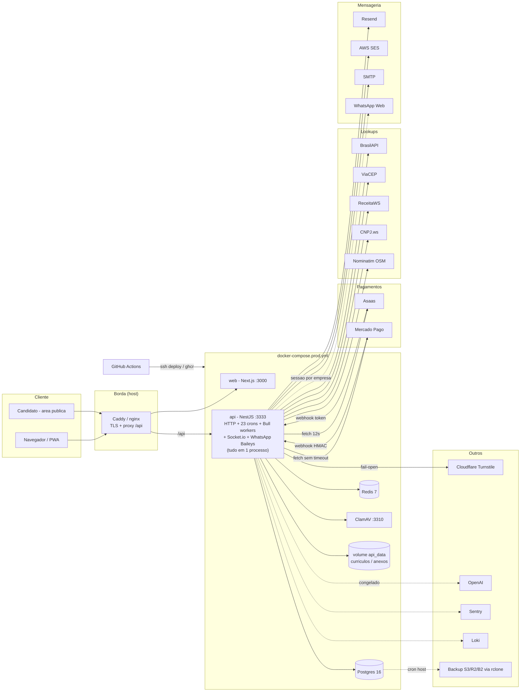

# 02 - Inventario de servicos, microsservicos e integracoes

Auditoria SOMENTE LEITURA. Data-base: 2026-10-29. Nenhum valor de segredo foi lido ou impresso; so os NOMES das variaveis.
Linhas citadas (arquivo:linha) refletem a arvore no momento da leitura (outros agentes editam em paralelo).

## 0. Resumo em numeros

| Item | Quantidade real |
|---|---|
| Arquivos com `@Module` na API | 46 (39 pastas em `apps/api/src/modules`, mais `common`, `health`, `database`) |
| `@Controller` / rotas HTTP | 78 controllers / 618 decoradores de rota |
| Filas Bull (`@nestjs/bull`) | 4: `pdf-generation`, `whatsapp-send`, `email-send`, `asaas-webhook` (so 2 fazem trabalho real) |
| `@Cron` (agendadores) | 23 (todos com `@CronLock`). Nenhum `@Interval`/`@Timeout` |
| Gateways WebSocket | 1 (`communication`, socket.io + adaptador Redis). Nenhum SSE |
| Integracoes externas de saida (hosts distintos) | 14 (Asaas, Mercado Pago, Resend, AWS SES, SMTP generico, ReceitaWS, BrasilAPI, ViaCEP, CNPJ.ws, Nominatim/OSM, Turnstile, OpenAI, ClamAV, WhatsApp/Baileys) + Sentry, Loki, Redis, logos HTTPS arbitrarias |
| Webhooks recebidos | 2 (`POST /finance/webhook/asaas`, `POST /finance/webhook/mercadopago`) |
| Variaveis de ambiente lidas no codigo da API | 102 nomes distintos (inclui `NODE_ENV`, `HOME`, seeds/scripts); +14 `ASAAS_NFSE_*` e 14 `INVOICE_*` lidas por helper `this.env()` |
| Variaveis do web (`process.env.NEXT_PUBLIC_*`) | 15 |
| Feature flags | 8 backend `FEATURE_*` + 8 web `NEXT_PUBLIC_FEATURE_*` (todas desligadas por padrao) |
| Modelos Prisma / enums | 135 modelos / 65 enums; 118 relacoes `onDelete: Cascade`, 40 com SetNull/Restrict/NoAction |
| Containers (prod `docker-compose.prod.yml`) | 5: db, redis, api, clamav, web |

## 1. Infraestrutura e containers

### 1.1 `docker-compose.prod.yml` (producao oficial, VPS)

| Servico | Imagem:tag | Portas | Volumes | Limite | Healthcheck | Depende de |
|---|---|---|---|---|---|---|
| db | `postgres:16-alpine` | nenhuma (so rede interna) | `postgres_data` | `DB_MEM_LIMIT` 1g; `max_connections=60` | `pg_isready` 10s/5s/10 | - |
| redis | `redis:7-alpine` (`--requirepass`, `--appendonly yes`) | nenhuma | `redis_data` | `REDIS_MEM_LIMIT` 384m (sem `maxmemory`/politica de eviction) | `redis-cli ping` | - |
| api | `ghcr.io/eduardo09e32y4rhf/innovation-api:${IMAGE_TAG:-latest}` | `127.0.0.1:3333` | `api_data:/data` (curriculos, anexos de suporte) | `API_MEM_LIMIT` 1g; heap 640MB | `wget /health/live` 20s, start 40s | db(healthy), redis(healthy); NAO espera clamav |
| clamav | `clamav/clamav:stable` | nenhuma | `clamav_data` | 2g (nao reduzir de ~1.5g) | **nenhum** | - |
| web | `ghcr.io/.../innovation-web:${IMAGE_TAG:-latest}` | `127.0.0.1:3000` | - | 640m; heap 384MB | `wget /` 30s | api (sem condition) |

Observacoes: `latest` e o default de tag (rollback depende de `IMAGE_TAG`); nenhum servico define `cpus`; a API roda como root (`apps/api/Dockerfile:1-11`, `node:24-alpine`, sem multi-stage, sem `USER`, sem `HEALTHCHECK` na imagem); o `NODE_ENV=production` obriga `KMS_MASTER_KEY`, `METRICS_TOKEN`, `ASAAS_WEBHOOK_TOKEN` e `MERCADOPAGO_WEBHOOK_SECRET` (ver riscos 4 e 5). Nao ha servico worker separado: crons, filas Bull, WhatsApp e API HTTP rodam no MESMO processo.

### 1.2 Demais compose

| Arquivo | Servicos | Pontos de atencao |
|---|---|---|
| `docker-compose.yml` (raiz, "producao antiga") | postgres (127.0.0.1:5435), redis (127.0.0.1:6379, **sem senha**), clamav `latest` (**3310 exposto em 0.0.0.0**), api, web (**3000 em 0.0.0.0**) | Sem `KMS_MASTER_KEY`/`METRICS_TOKEN`/segredos de webhook: com `NODE_ENV=production` a API recusa subir (`env.validation.ts:41-60`). Passa `DEV_PASSWORD`/`ADMIN_PASSWORD` em texto no ambiente. Sem limites de memoria. Obsoleto. |
| `infra/docker-compose.yml` | postgres + `pgbackup` (`@daily`, retencao 30d/4w/3m), api (porta 3001), web (nginx 80), **watchtower** (`/var/run/docker.sock`, intervalo 300s, `latest`), cadvisor (**privileged**), prometheus/loki/promtail/alertmanager/grafana/uptime-kuma (todos `latest`, portas em 0.0.0.0) | Usa nomes de variavel que o codigo nao le (`CORS_ORIGIN`, `JWT_EXPIRATION`); sem `REDIS_URL`, `ALLOWED_ORIGINS`, `KMS_MASTER_KEY`. `infra/prometheus.yml` aponta `api:3333`, `node-exporter` e `postgres-exporter`, que nao existem neste compose (0 ocorrencias). Watchtower + docker.sock + `latest` = atualizacao automatica sem aprovacao (conflita com o fluxo `deploy.yml`). |
| `infra/docker-compose.locaweb.yml` | postgres, api, web | Variante de hospedagem; sem redis/clamav. |
| `docker-compose.monitoring.yml` | `louislam/uptime-kuma:1.23.16` | Pinado; 256m. |
| `docker-compose.identity.yml` | keycloak-db (postgres:16), `keycloak:26.4.0` (1536m) | Servico auxiliar (SSO); o codigo da API NAO o referencia (nenhuma chamada Keycloak em `apps/api/src`). |
| `docker-compose.helpdesk.yml` | Zammad 6.5.0 (elasticsearch 8.17, postgres, redis, memcached, init, rails, scheduler, websocket, nginx) | ~6GB de limites somados; nao referenciado pelo codigo (suporte e proprio: modulo `support`). |
| `docker-compose.freescout.yml` | mariadb 11.4 + `freescout:${FREESCOUT_VERSION:-latest}` | Idem, helpdesk alternativo nao integrado. |
| `docker-compose.test.yml` | postgres-test (5436), redis-test (6380) | Apenas testes. |

### 1.3 Proxy reverso (`infra/`)

- `Caddyfile`: `{$DOMAIN}` -> `/api/*` (strip prefix) para `127.0.0.1:3333`, resto para `:3000`; subdominio `api.{$DOMAIN}` expoe a API inteira (inclusive `/metrics`, protegido so por `METRICS_TOKEN`). Sem rate limit, sem limite de corpo (a API limita via `body-limits.ts`).
- `nginx-lb.conf`: `client_max_body_size 50M`; upstreams `127.0.0.1:3333/3000` com `max_fails=3`; **hostname fixo `vps8369.panel.icontainer.net`** e certificado Let's Encrypt desse host. Sem `limit_req`. Um unico servidor por upstream: "lb" nao balanceia nada.
- `nginx-host-performance.conf`: cache de `/_next/static`, keepalive 16, `client_max_body_size 25m` (menor que os 50M do nginx-lb: inconsistencia).
- `nginx-uptime.conf`: proxy do uptime-kuma (`:3001`). `nginx-web.conf`: estatico do web em container nginx.
- `ecosystem.config.cjs` (PM2): 1 instancia fork de api e web, `max_memory_restart 2G` (alternativa a Docker).
- `render.yaml`: servico free `branch: feat/integracao-frontend`, `startCommand` roda `db:deploy && db:seed` a cada start (seed em producao).

### 1.4 Workflows `.github/workflows`

| Workflow | Gatilho | O que faz | Secrets/vars (nomes) |
|---|---|---|---|
| `ci.yml` | push/PR em `main`; `workflow_call` | validate (typecheck), **gitleaks** no historico completo (versao e SHA-256 pinados), unit + cobertura, migrations em banco vazio, integration (postgres:16 + redis:7), build, chama `e2e.yml` | nenhum secret; credenciais efemeras de CI |
| `e2e.yml` | `workflow_call`, manual | Playwright (fluxo publico + fluxos logados, viewport 360x740) com postgres/redis de servico | `E2E_PASSWORD` fixa em texto no YAML (so CI) |
| `deploy.yml` | push em `main`, manual | `ci` -> **staging** (SSH + `scripts/deploy/vps-update.sh <sha>` + smoke `/api/health`) -> **production** (environment com aprovadores; mesmo script + smoke) | `STAGING_HOST/USER/SSH_KEY`, `PROD_HOST/USER/SSH_KEY`; vars `STAGING_DIR/URL`, `PROD_DIR/URL` |
| `images.yml` | push em `main` e `claude/**`, manual | Build/push `ghcr.io/<owner>/innovation-{api,web}` com tags `<sha>` e `<branch>` (mutavel). Build do web SEM `NEXT_PUBLIC_FEATURE_*` | `GITHUB_TOKEN` |
| `rollback.yml` | manual | SSH `scripts/deploy/rollback.sh <ref> [--restore-db]` + smoke | `PROD_HOST/USER/SSH_KEY` |
| `release.yml` | tag `v*` | GitHub Release (`softprops/action-gh-release@v2`) | `GITHUB_TOKEN` |
| `codeql.yml` | push/PR `main` + cron seg 03:30 UTC | CodeQL SAST | - |
| `pr-title.yml` | PR | valida titulo (conventional) | - |
| `labels-sync.yml` | manual | sincroniza labels | `GITHUB_TOKEN` |

Notas: actions pinadas por tag (`@v4`, `@v3`), nao por SHA, inclusive `appleboy/ssh-action@v1.2.0` que recebe a chave SSH de producao; `images.yml` publica imagens de branches `claude/**` no mesmo repositorio de pacotes que o prod puxa com `IMAGE_TAG`.

### 1.5 Backup (fora da API)

`scripts/backup/backup.sh` (cron do host via `install-cron.sh`): `pg_dump | gzip` para `storage/backups`, retencao `BACKUP_KEEP_DAYS` (14), copia remota cifrada opcional (`BACKUP_REMOTE=s3` + `BACKUP_S3_*` + `BACKUP_ENCRYPTION_PASSPHRASE`). Se `BACKUP_REMOTE` ficar vazio, o backup vive no MESMO disco da VPS. Alem disso `apps/api/src/database/backup.service.ts:24` tenta um `pg_dump` a cada meia-noite DENTRO do container da API, onde `pg_dump` nao existe (a propria mensagem do codigo admite) e o diretorio `storage/backups` nao esta em volume.

## 2. API NestJS - modulos

`app.module.ts:35-130` registra `ScheduleModule.forRoot()` (todas as instancias executam todos os crons), `ThrottlerModule.forRoot([{ttl:60000, limit:300}])` (armazenamento EM MEMORIA, por instancia), `CacheModule` (Redis), `PrometheusModule`. Guards globais: FeatureFlag -> UserThrottler -> MfaEnrollment -> Tenant -> SubscriptionActive. Interceptors: Sanitize, Audit, Metrics.

| Modulo | Finalidade (1 linha) | Providers/rotas principais | Fila / cron / evento |
|---|---|---|---|
| accounting | Escritorio contabil: clientes, tarefas, checklist, honorarios, periodos | 8 services, ctl `accounting` | - |
| ai | IA (OpenAI) com guardrails e orcamento por tenant | `AiService`, `AiGuardrailsService`, `AiUsageService`, `PlatformAiService`; `@RequiresFeature('ai')` | - |
| analytics | Visitas da landing sem gravar IP (hash diario) | `AnalyticsService`, `GeoService` (GeoIP local) | cron `analytics.purge` 03:30 America/Sao_Paulo |
| auth | Login, MFA, sessoes/refresh, reset de senha, cadastro | `AuthService`, `SessionService`, `MfaService` | cron `auth.purgeSessions` 04:00 UTC |
| ceo-onboarding | Funil de ativacao do CEO | congelado (`FEATURE_CEO_ONBOARDING`) | - |
| commercial-sales | Vendas/comissoes do comercial | congelado | - |
| communication | Chat/WhatsApp (Baileys) e conversas em tempo real | `WhatsappProvider`, `OmniusAdapterService`, `CommunicationGateway` (WS ns `communication`) | consome fila `whatsapp-send`; `onModuleInit` em `communication.service.ts:87` |
| companies | Cadastro da empresa-cliente, geolocalizacao da sede | `GeocodingService` (Nominatim) | - |
| coupons | Cupons de desconto | 1 service | - |
| dashboard | Indicadores por papel | 1 service | - |
| document-templates | Modelos de documentos | ctl apenas | - |
| documents | Geracao de documentos/PDF | 1 service | - |
| employees | Funcionarios e importacao | 3 services, `employees/import` | - |
| finance | Cobranca SaaS: faturas, assinaturas, reembolsos, NFS-e, conciliacao | 18 services: `AsaasService`, `MercadoPagoService`, `PaymentProviderService`, `AsaasFiscalService`, `InvoicePdfService`, `BillingCronService`, `PaymentReconciliationService`, `PaymentRefundService`, `FinanceNotificationService` | filas `asaas-webhook` (processor) e `whatsapp-send` (produtor); 14 crons (secao 2.2) |
| holidays | Feriados nacionais (BrasilAPI + cache Redis 30d) | `HolidaysService` (sem controller; sem chamador fora de testes) | - |
| jobs | Recrutamento: vagas, funil, portal do candidato, banco de talentos, LGPD | 17 services, 12 controllers (varios `public/*`), `CandidateDocumentScannerService` (ClamAV) | 3 crons (talent, retencao, lembretes de entrevista) |
| lookup | Proxy de CEP e CNPJ para o navegador | `lookup.controller.ts` (BrasilAPI, ViaCEP, CNPJ.ws) | - |
| mail | E-mail transacional (Resend/SES/SMTP) | `MailService` | - |
| management | Gestao SST/ASO/eventos/documentos | `SstCron` | cron `sst.periodic-aso` 06:00 UTC |
| manual-contracts | Contratos manuais de cobranca | congelado | cron dentro de `billing-cron` (gate `FEATURE_MANUAL_CONTRACTS`) |
| notifications | Notificacoes in-app | 1 service | - |
| onboarding | Onboarding de funcionario | 1 service | - |
| partners | Parceiros e repasses | congelado | - |
| payroll | Folha, descontos, periodos | 3 services, 4 controllers | - |
| people-management | Pasta sem providers (vazia) | - | - |
| platform | Painel DEV: empresas, planos, permissoes globais, lookup CNPJ (ReceitaWS) | `PlatformService`, `GlobalPermissionsService` (`onModuleInit`) | - |
| platform-audit / platform-hub | Auditoria e hub do painel da plataforma | 1 service cada | - |
| privacy | LGPD: consentimentos, termos assinados (RSA opcional) | `PrivacyService` (injeta fila `pdf-generation`, hoje sem uso) | - |
| promotions | Promocao de funcionarios | congelado | cron `promotions.dailyJob` 06:10 America/Sao_Paulo (gate `FEATURE_PROMOTIONS`) |
| proposals | Propostas comerciais -> cobranca Asaas | congelado | gate `FEATURE_PROPOSALS` |
| queue | Registro das filas Bull e workers | `PdfGenerationWorker`, `WhatsappSendWorker`, `EmailSendWorker` | `BullModule.forRoot` com `redisConnection()` |
| schedule / schedule-hub | Escalas, trocas, ponto por batida (`punch`), geofence | 2 + 8 services | - |
| support | Tickets, SLA, anexos (ClamAV), reembolso assistido | 13 services | cron `support.slaCheck` a cada 5 min |
| time-track | Ponto, ocorrencias, regras, fechamento | 5 services | `onApplicationBootstrap` (`time-track.service.ts:361`) |
| users | Usuarios da empresa | 2 services | - |
| vacations | Ferias | 2 services | - |
| welcome | Mensagem de boas-vindas | ctl | - |
| common | Guards, interceptors, Redis (`RedisService`, `CronLock`), Turnstile, metricas, PDF, crypto (AES-256-GCM via `KMS_MASTER_KEY`), adaptador Socket.io-Redis | - | - |
| database | `PrismaService`, `BackupService` | - | cron `db.backup` 00:00 (TZ do container) |
| health | `/health/live`, `/health/ready`, `/health` | so DB e obrigatorio; Redis "degraded (optional)" | - |

### 2.1 Filas (Bull 4 via `@nestjs/bull`; `bullmq` tambem esta no package.json mas nao e usado)

| Fila | Produtor | Processor | Retry/backoff | Observacao |
|---|---|---|---|---|
| `asaas-webhook` | `asaas-webhook.controller.ts:68`, `finance.controller.ts:210` | `AsaasWebhookWorker` (`asaas-webhook.processor.ts:331`) job `process` | 5 tentativas, exponencial 10s | `removeOnFail: 1000`; estado duravel na tabela `AsaasWebhookEvent` |
| `whatsapp-send` | `finance-notification.service.ts:280` | `WhatsappSendWorker` (`whatsapp-send.worker.ts:19`) | 5, exponencial 30s | Payload da fila leva a mensagem e telefone em claro no Redis; midia como base64 no job |
| `email-send` | ninguem | `EmailSendWorker` (`email-send.worker.ts`) | - | Stub "Future implementation": consome e descarta. `MailService` envia direto, sem fila |
| `pdf-generation` | ninguem | `PdfGenerationWorker` | - | Descarta jobs legados |

Como o Redis e opcional no `RedisService` mas OBRIGATORIO para Bull, com Redis fora o enfileiramento de webhook falha (o controller marca o evento `FAILED` e responde 5xx para o Asaas reenviar).

### 2.2 Agendadores `@Cron` (23) e risco de duplicidade

Mecanismo: `@CronLock(nome, ttl)` (`common/redis/cron-lock.decorator.ts:30-52`) faz `SET NX PX` no Redis. Nao libera ao terminar com sucesso (expira pelo TTL). **Se o Redis estiver desconectado, `acquireLock` devolve `true` (`redis.service.ts:70`) e TODAS as instancias executam o job** (fail-open). Com 1 instancia (situacao atual do compose) nao ha duplicidade; com 2+ instancias e Redis instavel, os jobs de cobranca duplicam.

| Cron (nome do lock) | Frequencia | Arquivo:linha | O que faz | Risco se duplicar |
|---|---|---|---|---|
| billing.reconcileFiscalInvoices | `20 */3 * * *` | billing-cron.service.ts:39 | Concilia NFS-e com Asaas | baixo (leitura/sync) |
| billing.repairAsaasAssociations | `*/30 * * * *` | :46 | Repara vinculos fatura-Asaas | medio |
| billing.auditOperationalConsistency | `0 * * * *` | :86 | Auditoria de consistencia | baixo |
| billing.applyScheduledSeatReductions | `0 2 * * *` | :115 | Aplica reducao de vagas | **alto** (altera assinatura e valor) |
| billing.applyScheduledPlanChanges | `15 2 * * *` | :174 | Troca de plano agendada | **alto** |
| billing.applyScheduledCancellations | `30 2 * * *` | :167 | Cancelamentos agendados | **alto** (cancela no Asaas) |
| billing.createTrialConversionProposals | `30 3 * * *` | :206 | Gera propostas de fim de trial | **alto** (cobranca duplicada) |
| billing.sendTrialCountdownWarnings | `10 * * * *` | :271 | E-mails de fim de trial | medio (spam) |
| billing.checkExpiredTrials | `0 4 * * *` | :279 | Suspende trials vencidos | medio |
| billing.checkExpiredManualContracts | `30 4 * * *` | :341 | Vence contratos manuais (gate flag) | medio |
| billing.checkOverdueInvoices | `0 8 * * *` | :362 | Regua de inadimplencia (aviso/bloqueio/cancelamento) | **alto** |
| billing.sendPaymentReminders | `0 9 * * *` | :424 | Lembretes de pagamento (e-mail/WhatsApp) | medio (idempotencia por chave em `FinanceNotificationLog`) |
| billing.reconcilePayments | `10 */6 * * *` | payment-reconciliation.service.ts:58 | Concilia pagamentos Asaas/MP | medio |
| finance.reconcileRefunds | `0 */5 * * * *` (5 min) | payment-refund.service.ts:167 | Conciliacao de devolucoes, `retries: 2` | **alto** (estorno) |
| recruitment.interview-reminders | `10 * * * *` | interview-followup.service.ts:123 | Lembretes de entrevista | medio |
| recruitment.retention | `30 3 * * *` | recruitment-privacy.service.ts:237 | Retencao/anonimizacao LGPD de candidatos | medio (idempotente) |
| talent.consent-expiry | `15 4 * * *` | talent-pool.service.ts:71 | Expira consentimento do banco de talentos | baixo |
| auth.purgeSessions | `0 4 * * *` | session.service.ts:126 | Remove sessoes expiradas | baixo |
| sst.periodic-aso | `0 6 * * *` | management/sst/sst.cron.ts:19 | ASOs periodicos | medio |
| promotions.dailyJob | `10 6 * * *` SP | promotions.service.ts:122 | Promocoes (flag) | baixo |
| support.slaCheck | `*/5` | support-sla.scheduler.ts:12 | SLA de tickets | medio (notifica) |
| analytics.purge | `30 3 * * *` SP | analytics.scheduler.ts:12 | Apaga chaves/visitas antigas | baixo |
| db.backup | meia-noite | backup.service.ts:24 | `pg_dump` no container | baixo (inoperante) |

Fuso: so analytics e promotions declaram `timeZone`. Os demais rodam em UTC: `billing.checkOverdueInvoices` 08:00 UTC = 05:00 em Brasilia; `sendPaymentReminders` 09:00 UTC = 06:00 em Brasilia (clientes recebem lembrete de madrugada).

### 2.3 Tempo real

Unico gateway: `communication.gateway.ts:10` (socket.io, namespace `communication`, CORS por `ALLOWED_ORIGINS`), com `RedisIoAdapter` (`redis-io.adapter.ts:15`, pub/sub, falha de conexao nao derruba o boot). **Sem autenticacao no handshake**: o middleware (`redis-io.adapter.ts:49-69`) so limita 50 conexoes/min por `companyId` (valor enviado pelo proprio cliente em `query`/`auth`) ou IP, e ignora o limite se o Redis cair; nao ha verificacao de JWT nem `socket.join(...)` em `communication/realtime`. `emitToCompany` faz `server.to(companyId).emit`, entao ou ninguem recebe (ninguem entra na sala) ou algum cliente entra por outro caminho sem validacao. Sem SSE. Sem `@OnEvent`/EventEmitter: nao ha barramento de eventos interno.

## 3. Integracoes externas (saida)

Legenda: T = timeout; R = retry; I = idempotencia; Q = se cair.

| # | Servico | arquivo:linha | URL base | Auth (variavel) | T | R | I | Q (cai o servico externo) |
|---|---|---|---|---|---|---|---|---|
| 1 | **Asaas** (cobranca, assinaturas, estorno, NFS-e) | `finance/asaas.service.ts:84` | `ASAAS_API_URL` ou `https://api.asaas.com/v3` (prod) / `api-sandbox.asaas.com/v3`; sandbox se chave contem `hmlg`/`sandbox` | `ASAAS_API_KEY` (header `access_token`) | 12 s (`:88`) | nenhum no cliente; reconciliacao por cron | sem header de idempotencia; deduplica por `externalReference` (`:165`) | 400/404/422 -> `AsaasRejectedException`; demais -> 503 `ServiceUnavailable`. **Sem chave: `request` devolve `{}` com apenas um warn (`:75-78`)**, quebrando silenciosamente quem espera `id`. Quebra a criacao de cobranca; resto do sistema segue |
| 2 | **Mercado Pago** | `finance/mercadopago.service.ts:78` | `https://api.mercadopago.com` | `MERCADOPAGO_ACCESS_TOKEN` (Bearer) | **nenhum** | nenhum | `X-Idempotency-Key` em preferencia (`pref:<ref>`); assinatura usa UUID por chamada (nao idempotente de proposito) | rede -> 503; 404 -> NotFound; 5xx -> 503. Sem timeout, uma resposta pendurada segura a requisicao |
| 3 | **Resend** (e-mail) | `mail/mail.service.ts:59` | `https://api.resend.com/emails` | `RESEND_API_KEY` + `MAIL_FROM` | 10 s | nenhum | nenhuma | `send()` nunca lanca: retorna `{sent:false}` e loga. Reset de senha/convite se perdem sem reenfileirar |
| 4 | **AWS SES v2** (assinatura SigV4 manual) | `mail/mail.service.ts:113` | `https://email.<AWS_SES_REGION>.amazonaws.com/v2/email/outbound-emails` | `AWS_ACCESS_KEY_ID`, `AWS_SECRET_ACCESS_KEY`, `AWS_SESSION_TOKEN`, `AWS_SES_REGION` | 10 s | nenhum | nenhuma | idem Resend |
| 5 | **SMTP** (nodemailer) | `mail/mail.service.ts:72` | `SMTP_HOST:SMTP_PORT` | `SMTP_USER`, `SMTP_PASS`, `SMTP_SECURE` | conexao 8 s / socket 12 s | nenhum | nenhuma | idem |
| 6 | **ReceitaWS** (CNPJ, painel DEV) | `platform/platform.service.ts:314` | `https://www.receitaws.com.br/v1/cnpj/` | nenhuma (plano gratis: ~3 consultas/min) | **nenhum** | nenhum | n/a | qualquer erro vira `ConflictException` (409) com a mensagem; sem fallback |
| 7 | **BrasilAPI** CEP e CNPJ + **CNPJ.ws** (reserva) + **ViaCEP** (reserva) | `lookup/lookup.controller.ts:10` (`getJson`) | `brasilapi.com.br/api/{cep,cnpj}/v1`, `viacep.com.br/ws`, `publica.cnpj.ws/cnpj` | nenhuma | 6 s (CEP) / 8 s (CNPJ) | fallback entre provedores | n/a | devolve 404 amigavel; formulario cai para preenchimento manual (degrada bem). `lookupCep` tambem serve a rota do candidato (`jobs/candidate-account.controller.ts:62`) |
| 8 | **BrasilAPI feriados** | `holidays/holidays.service.ts:28` | `https://brasilapi.com.br/api/feriados/v1/<ano>` | nenhuma | **nenhum** | nenhum | `deleteMany`+`createMany` em transacao + cache Redis 30d | erro e engolido; **sem chamador no codigo** (codigo morto na pratica) |
| 9 | **Nominatim/OSM** geocodificacao da sede | `companies/geocoding.service.ts:13` (chamado por `companies.service.ts:44`) | `https://nominatim.openstreetmap.org/search` | `User-Agent: InnovationRH/1.0` | **nenhum** | nenhum | n/a | retorna `null`; mas sem timeout, cadastro da empresa pode pendurar |
| 10 | **Nominatim** reverso no ponto (2 copias) | `schedule-hub/punch/punch.service.ts:53` (usado em `:185`, caminho quente da batida) e `time-track/time-track.service.ts:49` (usado em `:270`) | `https://nominatim.openstreetmap.org/reverse` | `User-Agent` | punch.service: **nenhum**; time-track: 2,5 s | nenhum | n/a | retorna `null` (batida segue sem endereco). Politica do Nominatim: max 1 req/s e proibe uso comercial intenso; sem cache |
| 11 | **Cloudflare Turnstile** | `common/turnstile/turnstile.service.ts:31` | `https://challenges.cloudflare.com/turnstile/v0/siteverify` | `TURNSTILE_SECRET_KEY` (desligado se ausente) | 5 s | nenhum | n/a | **fail-open** em HTTP != 200, timeout e erro de configuracao: bot passa se a Cloudflare cair ou a chave estiver errada |
| 12 | **OpenAI** (moderacao + structured outputs) | `ai/ai.service.ts:3,22,54` | SDK `openai@6.49` (api.openai.com) | `OPENAI_API_KEY`, `OPENAI_AI_ENABLED`, `OPENAI_MODEL_FAST/REASONING`, `OPENAI_MONTHLY_BUDGET` | 15 s por chamada de geracao; moderacao sem timeout explicito | SDK default (2 retries) | n/a | devolve `fallbackData` deterministico; orcamento mensal por tenant em `AiUsageLog`. Modulo congelado (`FEATURE_AI`) e as variaveis NAO sao repassadas pelo compose de prod |
| 13 | **ClamAV** (clamd TCP 3310) | `jobs/candidate-document-scanner.service.ts:21`, `support/support-attachment.service.ts:24` | `CLAMAV_HOST:CLAMAV_PORT` (padrao `clamav:3310`) | rede interna | 60 s | reinicia o cliente apos 30 s | n/a | **falha fechada em producao** (503, curriculos e anexos bloqueados); fora de prod aceita sem scan. O compose nao tem healthcheck nem `depends_on` do clamav; na 1a subida baixa assinaturas por minutos |
| 14 | **WhatsApp (Baileys nao oficial)** | `communication/whatsapp/whatsapp.provider.ts:48-111` | WebSocket do WhatsApp Web | sessao em disco `WHATSAPP_SESSION_PATH` (padrao `./storage/whatsapp`) | - | reconecta apos 5 s (`:111`) | n/a | sessoes por empresa em memoria do processo: nao escala para 2 instancias; sessao so persiste se o caminho estiver em volume (prod NAO define `WHATSAPP_SESSION_PATH`; `WHATSAPPMEDIA_PATH` so no compose da raiz e nao e lido). Violacao potencial de ToS do WhatsApp (risco de banimento). `omnius-adapter.service.ts:170-178` faz `require` de `WHATSAPP/services/omnius-core/*` que nao existe no repositorio |
| 15 | **Redis** | `common/redis/redis.service.ts:12`, `redis-io.adapter.ts:15`, `queue.module.ts:12` | `REDIS_URL` ou `REDIS_HOST/PORT/PASSWORD` | `REDIS_PASSWORD` | connect 3 s, comando 1,5 s | `retryStrategy` infinita (max 5 s) | locks `SET NX` | **degrada**: cache, lock e `incr` viram no-op. Consequencias: `RateLimitGuard` nunca limita (`incr` devolve 0, `redis.service.ts:125`), cron lock fail-open, Bull inoperante |
| 16 | **Sentry** | `common/observability.ts:7-14` | DSN | `SENTRY_DSN` | SDK | SDK | n/a | desligado sem DSN; sem scrubbing de PII configurado (`sendDefaultPii` default false) |
| 17 | **Loki** (logs) | `main.ts:35` (winston-loki) | `LOKI_HOST` | nenhuma | - | - | n/a | so ativa com a variavel; `onConnectionError` so imprime |
| 18 | **Logo HTTPS arbitrario** (PDF) | `common/pdf/pdf-report.ts:122` | URL fornecida pelo tenant (`logoUrl`) | nenhuma | 5 s | nenhum | n/a | cai para iniciais. Bloqueia localhost/IP literal/`.internal`, `redirect: 'error'`, 1,5 MB; mas hostname que resolve para IP privado (DNS) nao e checado: risco de SSRF cego |
| 19 | **pg_dump / rclone / S3-R2-B2** (backup) | `scripts/backup/*.sh` | `BACKUP_S3_*` | `BACKUP_ENCRYPTION_PASSPHRASE` | - | - | - | opcional; sem destino remoto o backup fica na VPS |

Nao ha SDK de S3/storage de objetos no codigo: anexos e curriculos ficam em disco (`RECRUITMENT_RESUMES_PATH`, `SUPPORT_ATTACHMENTS_PATH`, volume `api_data`). Nao ha Axios/got/undici (todas as chamadas usam `fetch` nativo). Nao ha cliente WhatsApp Cloud API oficial, nem Google Calendar ativo (so referencias dentro do adapter Omnius).

## 4. Webhooks recebidos

| Rota | Verificacao | Idempotencia | Replay | Observacoes |
|---|---|---|---|---|
| `POST /finance/webhook/asaas` (`asaas-webhook.controller.ts:26`) | header `asaas-access-token` comparado em tempo constante com `ASAAS_WEBHOOK_TOKEN` (ou `ASAAS_WEBHOOK_SECRET`) (`:86-100`). Sem token configurado: 403 (bypass `ASAAS_WEBHOOK_INSECURE=true` so fora de producao) | Evento persistido em `AsaasWebhookEvent` com `asaasEventId` unico (id do payload ou `evento:paymentId`); duplicata so reenfileira se `PENDING`; processamento assincrono com retry 5x | Token estatico, nao ha timestamp: um evento antigo capturado pode ser reenviado, mas e neutralizado pela chave de evento ja `PROCESSED`. Fallback de id `evento:paymentId` colapsa eventos legitimos distintos do mesmo tipo e pagamento | `@SkipThrottle()` (sem limite de taxa na rota publica); `create` e `findUnique` separados (race tratada com catch) |
| `POST /finance/webhook/mercadopago` (`mercadopago-webhook.controller.ts:34`) | HMAC-SHA256 do manifesto `id:<data.id>;request-id:<x-request-id>;ts:<ts>;` com `MERCADOPAGO_WEBHOOK_SECRET`, comparacao em tempo constante; janela de `ts` de 300 s (`MERCADOPAGO_WEBHOOK_TOLERANCE_SECONDS`) em `mercadopago.service.ts:214-230` | Sem tabela de eventos: idempotencia por ESTADO da fatura (PAID+PAID -> `duplicate`), sempre reconsulta o pagamento na API do MP (nao confia no corpo) | janela de 5 min barra replay tardio; dentro da janela o mesmo evento pode reentrar (inofensivo pelo estado) | Processamento SINCRONO dentro da requisicao: `$transaction` de fatura+empresa+auditoria; falha em chamada ao MP devolve 5xx e o MP reenvia. Cupom: `decrement` de `couponCyclesLeft` NAO e idempotente se o pagamento reentrar apos fatura ainda nao marcada PAID (corrida entre dois webhooks simultaneos) |

Nenhum outro endpoint publico recebe callback de terceiros (WhatsApp usa socket de saida). Rotas `public/*` do modulo `jobs` e `analytics` sao publicas por desenho (candidatos/landing), protegidas por Turnstile/limites.

## 5. Variaveis de ambiente

Fonte: varredura de `process.env.X`, `env.X`, `config.get('X')` em `apps/api` e `apps/web` (script no scratchpad, sem executar o app). Padrao entre parenteses quando existe no codigo. "Obrig." = o boot falha sem ela em producao (`config/env.validation.ts`).

### 5.1 API - obrigatorias em producao
`DATABASE_URL` (+ senha >= 16 e SSL se remoto), `JWT_SECRET` (>= 32), `KMS_MASTER_KEY` (64 hex, diferente do JWT), `ALLOWED_ORIGINS`, `METRICS_TOKEN` (>= 16), `ASAAS_WEBHOOK_TOKEN` (>= 32; ou `ASAAS_WEBHOOK_SECRET`), `MERCADOPAGO_WEBHOOK_SECRET` (>= 16). `REDIS_URL` precisa de senha se presente.

### 5.2 API - opcionais (nome: uso, primeiro uso)
- Servidor: `PORT`/`API_PORT` (3333), `HOST` (0.0.0.0) main.ts:115; `TRUST_PROXY` (`loopback,uniquelocal`) main.ts:48; `APP_URL`/`NEXT_PUBLIC_APP_URL`/`BASE_URL` (links em e-mails, MP); `APP_VERSION` (Sentry release).
- Auth/sessao: `JWT_EXPIRES_IN` (15m), `REFRESH_TTL_DAYS`, `SESSION_ABSOLUTE_DAYS` session.service.ts:14-16; `MFA_ENFORCE`, `MFA_ENFORCE_ROLES` mfa.service.ts:16-18; `TEMPORARY_PASSWORD_TTL_HOURS` (24); `SECRET_KEY` (legado, alias de `JWT_SECRET`); `TRIAL_DOCUMENT_HASH_SECRET` auth.service.ts:690; `PLATFORM_OWNER_USER_ID`, `PLATFORM_OWNER_EMAIL`; `COMPANY_DOCUMENT_OPTIONAL` (somente homologacao); `CEO_ONBOARDING_ENFORCEMENT`.
- Redis: `REDIS_URL`, `REDIS_HOST`, `REDIS_PORT`, `REDIS_PASSWORD`.
- Pagamentos: `PAYMENT_PROVIDER` (ASAAS), `ASAAS_API_KEY`, `ASAAS_API_URL`, `ASAAS_DEFAULT_BILLING_TYPE` (PIX), `ASAAS_WEBHOOK_INSECURE`, `ASAAS_NFSE_*` (ENABLED, NATIONAL, SERVICE_ID, SERVICE_CODE, SERVICE_NAME, DESCRIPTION, OBSERVATIONS, RETAIN_ISS, ISS, COFINS, CSLL, INSS, IR, PIS), `MERCADOPAGO_ACCESS_TOKEN`, `MERCADOPAGO_SANDBOX`, `MERCADOPAGO_WEBHOOK_INSECURE`, `MERCADOPAGO_WEBHOOK_TOLERANCE_SECONDS` (300), `ALLOW_MOCK_PAYMENTS`, `INVOICE_ISSUER_*` (NAME, LEGAL_NAME, DOCUMENT, ADDRESS, EMAIL, PHONE, SITE), `INVOICE_BOLETO_*` (BENEFICIARY, BENEFICIARY_DOCUMENT, AGENCY, WALLET, SPECIES, ACCEPT), `PLATFORM_TAX_RATE_PERCENT`.
- Cobranca/regua: `BILLING_GRACE_DAYS` subscription.guard.ts:44; `DUNNING_WARN_DAY`, `DUNNING_BLOCK_DAY`, `DUNNING_CANCEL_DAY` dunning.ts:14; `TRIAL_DAYS_DEFAULT`; `FINANCE_NOTIFICATION_REMINDER_DAYS_BEFORE`, `FINANCE_NOTIFICATION_OVERDUE_DAYS`, `FINANCE_WHATSAPP_NOTIFICATIONS_ENABLED`, `PLATFORM_WHATSAPP_SESSION_KEY`; `REFUND_FULL_WINDOW_DAYS`, `REFUND_DUAL_APPROVAL_ABOVE`.
- E-mail: `MAIL_FROM`, `MAIL_REQUIRED`, `RESEND_API_KEY`, `AWS_SES_REGION`, `AWS_ACCESS_KEY_ID`, `AWS_SECRET_ACCESS_KEY`, `AWS_SESSION_TOKEN`, `SMTP_HOST/PORT/USER/PASS/SECURE`.
- Seguranca de arquivos/privacidade: `CLAMAV_HOST` (localhost), `CLAMAV_PORT` (3310), `RECRUITMENT_RESUMES_PATH`, `SUPPORT_ATTACHMENTS_PATH`, `PRIVACY_RSA_PRIVATE_KEY` (assinatura do termo; ausente = termo sem assinatura), `TURNSTILE_SECRET_KEY`.
- Observabilidade: `SENTRY_DSN`, `SENTRY_ENV`, `SENTRY_TRACES_SAMPLE_RATE` (0), `LOKI_HOST`, `METRICS_TOKEN`.
- IA/WhatsApp: `OPENAI_API_KEY`, `OPENAI_AI_ENABLED` (true), `OPENAI_MODEL_FAST` (gpt-4o-mini), `OPENAI_MODEL_REASONING` (gpt-4o), `OPENAI_MONTHLY_BUDGET` (500000), `AI_SERVICE_URL` (`http://localhost:8001`, sem uso: nenhum cliente a consome), `WHATSAPP_SESSION_PATH`.
- Analytics: `ANALYTICS_SALT` (cai em `JWT_SECRET`, depois `'dev-only-salt'`), `ANALYTICS_RETENTION_DAYS`, `GEOIP_DB_PATH`.
- Seeds/scripts (nao runtime): `DEV_EMAIL`, `DEV_SEED_PASSWORD`, `SEED_DEFAULT_PASSWORD`, `PLATFORM_COMPANY_DOCUMENT`, `DEMO_COMPANY_DOCUMENT`, `RECALC_FROM/TO`, `HOME`, `USERPROFILE`, `VITEST`, `NODE_ENV`.

### 5.3 Web (build-time, `NEXT_PUBLIC_*`)
`NEXT_PUBLIC_API_URL` (/api), `NEXT_PUBLIC_CDN_URL`, `NEXT_PUBLIC_COMPANY_DOCUMENT_OPTIONAL`, `NEXT_PUBLIC_ENABLE_LOCAL_SESSION` (ignorada em producao em `AuthContext.tsx:64`), `NEXT_PUBLIC_TURNSTILE_SITE_KEY`, `NEXT_PUBLIC_ROBO_QA` (default **on** em `apps/web/Dockerfile:11` e no compose), mais as 8 flags da secao 6.

### 5.4 Divergencias com `.env.example`, `.env.prod.example`, `infra/.env.prod.example`, `.env.test.example`
- **No codigo, ausentes de todos os exemplos**: `KMS_MASTER_KEY` (OBRIGATORIA em prod!), `TURNSTILE_SECRET_KEY`, `SENTRY_DSN/ENV/TRACES_SAMPLE_RATE`, `LOKI_HOST`, `PRIVACY_RSA_PRIVATE_KEY`, `TRIAL_DOCUMENT_HASH_SECRET`, `SECRET_KEY`, `MAIL_REQUIRED`, `MERCADOPAGO_SANDBOX`, `MFA_ENFORCE_ROLES`, `REFRESH_TTL_DAYS`, `SESSION_ABSOLUTE_DAYS`, `BILLING_GRACE_DAYS`, `DUNNING_*_DAY`, `PLATFORM_TAX_RATE_PERCENT`, `RECRUITMENT_RESUMES_PATH`, `SUPPORT_ATTACHMENTS_PATH`, `ALLOW_MOCK_PAYMENTS`, `AI_SERVICE_URL`, `APP_VERSION`, `BASE_URL`.
- **Nos exemplos, mortas no codigo** (nenhuma leitura em `apps/`, `scripts/`, `tests-e2e/`): `COMPREFACE_URL`, `COMPREFACE_API_KEY`, `FINANCE_NOTIFICATIONS_ENABLED`, `FINANCE_EMAIL_NOTIFICATIONS_ENABLED`, `FINANCE_INTERNAL_NOTIFICATIONS_ENABLED` (o codigo le `FINANCE_WHATSAPP_NOTIFICATIONS_ENABLED`), `FRONTEND_URL`, `NEXT_PUBLIC_WS_URL`, `OPENAI_INPUT_COST_PER_1K`, `OPENAI_OUTPUT_COST_PER_1K`, `POSTGRES_PORT`, `ENABLE_LOCAL_SESSION` (o web le `NEXT_PUBLIC_ENABLE_LOCAL_SESSION`), `ROBO_QA_BANCO_DE_TESTE`, `ROBO_QA_SENHA`. So usadas por compose/Caddy e nao pelo codigo: `API_HOST_PORT`, `WEB_HOST_PORT`, `WEB_PORT`, `POSTGRES_*`, `REDIS_HOST_PORT`, `DOMAIN`, `CADDY_EMAIL`, `NEXT_PUBLIC_API_BASE(_URL)`, `MERCADOPAGO_PUBLIC_KEY`, `WHATSAPPMEDIA_PATH`.
- **Lidas pelo codigo mas NAO repassadas por `docker-compose.prod.yml`** (logo inertes em producao, mesmo que estejam no `.env`): `FEATURE_*` (todas), `TRUST_PROXY`, `ANALYTICS_SALT`, `PRIVACY_RSA_PRIVATE_KEY`, `TRIAL_DOCUMENT_HASH_SECRET`, `WHATSAPP_SESSION_PATH`, `TURNSTILE_SECRET_KEY`, `OPENAI_*`, `REFRESH_TTL_DAYS`, `GEOIP_DB_PATH`, `PLATFORM_WHATSAPP_SESSION_KEY`, `SESSION_ABSOLUTE_DAYS`, `BILLING_GRACE_DAYS`, `DUNNING_*`, `ASAAS_WEBHOOK_SECRET`, `MAIL_REQUIRED`, `MERCADOPAGO_WEBHOOK_TOLERANCE_SECONDS`.
- `.env` real existe na raiz (ignorado pelo git, `.gitignore:55`; nao lido).

## 6. Feature flags

Backend: `FEATURE_<NOME>` (true/1/on/yes; padrao DESLIGADO; valor invalido derruba o boot, `feature-flags.ts`). `FeatureFlagGuard` e o 1o guard global: rota de modulo congelado responde 404. Web: `NEXT_PUBLIC_FEATURE_<NOME>`, variavel de BUILD, uma leitura literal por flag (`apps/web/app/lib/feature-flags.ts:20-30`).

| Flag (API / Web) | Liga | Gate |
|---|---|---|
| `FEATURE_AI` / `NEXT_PUBLIC_FEATURE_AI` | modulo de IA (OpenAI) | `ai.controller.ts:16` |
| `FEATURE_PARTNERS` | parceiros e repasses | `partners.controller.ts:13` |
| `FEATURE_COMMERCIAL_SALES` | vendas e comissoes | `commercial-sales.controller.ts:14` |
| `FEATURE_PROPOSALS` | propostas -> cobranca; tambem o cron de conversao de trial (`billing-cron.service.ts:210`) | `proposals.controller.ts:9` |
| `FEATURE_MANUAL_CONTRACTS` | contratos manuais; cron `checkExpiredManualContracts` (`:344`) | `manual-contracts.controller.ts:17` |
| `FEATURE_CEO_ONBOARDING` | funil do CEO e `ceo-onboarding-gate.ts:13` | `ceo-onboarding.controller.ts:17` |
| `FEATURE_COMMUNICATION` | chat/WhatsApp | `communication.controller.ts:15` |
| `FEATURE_PROMOTIONS` | promocoes + cron `promotions.dailyJob` (`promotions.service.ts:125`) | `promotions.controller.ts:16` |

Pontos: (a) o compose de producao nao repassa `FEATURE_*` nem aceita build-args `NEXT_PUBLIC_FEATURE_*`, e `images.yml` constroi o web sem eles: ligar uma flag em prod exige editar compose e rebuild; (b) as flags so protegem rotas HTTP: `WhatsappSendWorker` e `FinanceNotificationService` (fila WhatsApp) continuam ativos com `FEATURE_COMMUNICATION=false`; o `CommunicationGateway` e o adaptador Socket.io tambem sobem; (c) outras chaves de ambiente funcionam como flags sem o prefixo: `MFA_ENFORCE`, `ASAAS_NFSE_ENABLED`, `COMPANY_DOCUMENT_OPTIONAL`, `MAIL_REQUIRED`, `OPENAI_AI_ENABLED`, `ALLOW_MOCK_PAYMENTS`, `*_WEBHOOK_INSECURE`, `NEXT_PUBLIC_ROBO_QA`.

## 7. Mapa de dados (Prisma, `apps/api/prisma/schema.prisma`, 3992 linhas)

135 modelos, 65 enums. Agrupamento por dominio:

| Dominio | Qtd | Modelos |
|---|---|---|
| Nucleo/tenant/identidade | 10 | Company, User, TemporaryCredential, RefreshSession, GlobalRolePermission, PlatformSetting, CEOProfile, CEOContract, PrivacyConsent, CompanyPosition |
| Pessoas/SST | 9 | Employee, TerminationRecord, MedicalCertificate, ManagementEvent, EmployeeAsoRecord, AsoClinicPreset, Commitment, Attachment, ActivityHistory |
| Ponto/jornada/escalas | 21 | TimeTrack, WorkScheduleRule, TimeOccurrence, OvertimeBank, OvertimeRule, Holiday, FaceEnrollment, FaceClockAttempt, TimeClosing, TimeClosingAdjustment, TimesheetAck, Schedule, UserSchedule, ScheduleException, ScheduleSwapRequest, ScheduleRequest, TimeRecord, TimePunch, PunchEvent, Geofence, TimePunchPolicy |
| Ferias | 4 | Vacation, VacationEntitlement, VacationPayment, VacationAuditLog |
| Folha/RH financeiro | 7 | Payroll, PayrollItem, PayrollTaxTable, PayrollDeductionRule, FinancialTransaction, PromotionPolicy, EmployeePromotion |
| Recrutamento e portal do candidato | 34 | Job, HiringPipeline, PipelineStage, JobQuestion, JobCriterion, Application*, Candidate*, Recruitment*, Interview*, JobOffer, JobAssessment, AssessmentInvite, JobApproval, JobTemplate, AreaHeadcount, JobRecruiter etc. |
| Cobranca da plataforma | 19 | PlatformPlan, PlatformInvoice, PaymentAttempt, PaymentRefund, InvoiceAdjustment, CompanySubscription, AsaasWebhookEvent, CompanyFinanceConfig, FinanceNotificationLog, PlatformContract, ManualContract, Proposal, ProposalAuditLog, PromotionCoupon, CouponRedemption, Partner, PartnerInvoice, CommercialSale, CommissionEntry |
| Suporte | 5 | SupportTicket, SupportTicketMessage, SupportAttachment, SupportTicketEvent, SupportTicketCounter |
| Comunicacao/notificacoes | 6 | WhatsappInstance, Contact, Conversation, Message, Notification, NotificationRecipient |
| Contabilidade | 6 | AccountingClient, AccountingTask, AccountingChecklistItem, AccountingDocRequest, AccountingFee, AccountingPeriod |
| Onboarding/desempenho | 8 | OnboardingFlow/Task/Document, PerformanceReview/Evaluation, OKR, Objective, KeyResult |
| Auditoria/IA/analytics/documentos | 6 | AuditLog, PlatformAuditLog, AiUsageLog, SiteVisit, DocumentTemplate, GeneratedDocument |

### Cascades perigosos (apagam historico fiscal/trabalhista)

`Company` -> (Cascade) `Employee` -> (Cascade) todo o historico trabalhista. Um unico `DELETE` de empresa ou funcionario apaga, via banco:
- Ponto: `TimeTrack`, `TimeRecord`/`TimePunch`, `PunchEvent`, `TimeOccurrence`, `OvertimeBank`, `TimeClosing` + `TimeClosingAdjustment`, `FaceEnrollment`, `WorkScheduleRule` (retencao legal do ponto: Portaria 671/2021, 5 anos).
- Folha: `Payroll` + `PayrollItem`, `FinancialTransaction`, `PayrollDeductionRule`.
- Ferias: `Vacation`, `VacationEntitlement`, `VacationPayment`, `VacationAuditLog`.
- Saude ocupacional: `MedicalCertificate`, `EmployeeAsoRecord`, `ManagementEvent` (ASO/PCMSO exige guarda de 20 anos).
- Auditoria: `AuditLog` -> Company Cascade (`schema.prisma` linha da relacao em `AuditLog`, 1226): apagar a empresa apaga a trilha de auditoria, e `purgeCompany` a apaga explicitamente antes.
- Cobranca: `CompanySubscription`, `FinanceNotificationLog`, `PaymentAttempt` (via invoice). `PlatformInvoice.company` NAO tem cascade (Restrict por padrao), o que protegeria faturas/NFS-e... mas `purgeCompany` as remove manualmente (`platform.repository.ts:384`).
- Recrutamento: `Application*` e `Candidate` em cascata de `Company`/`Job` (coerente com LGPD, mas apaga evidencia de processo seletivo).
- `User` -> `CEOContract`, `RefreshSession`, `Notification*`, `TemporaryCredential` em cascata.

Entradas de exclusao definitiva no codigo: `employees.repository.ts:319-323` (`deleteWithHistory`, chamado por `employees.service.ts:379`), `platform.repository.ts:380-389` (`purgeCompany`, rota `DELETE /platform/companies/:id/purge`, so `assertDev`), `auth.repository.ts:223-228` (`deleteIncompleteCompany`), `users.repository.ts:328`.

## 8. Diagrama

## 9. Dez maiores riscos (resumo; detalhes na secao indicada)

1. **Exclusao em cascata apaga historico trabalhista/fiscal sem soft-delete** - `platform.repository.ts:380-389` (`purgeCompany` apaga faturas, auditoria, usuarios e a empresa) e `employees.repository.ts:319-323` / `employees.service.ts:379` (`deleteWithHistory`), sobre 118 `onDelete: Cascade` do `schema.prisma`. Viola retencao de ponto/ASO/folha. Sem confirmacao dupla nem copia previa.
2. **Crons de cobranca sem protecao de duplicidade quando o Redis cai** - `redis.service.ts:68-76` (`acquireLock` devolve `true` sem conexao) + `cron-lock.decorator.ts:34-39`. Em 2+ instancias, `billing-cron.service.ts:115,167,174,206,362` e `payment-refund.service.ts:167` podem cobrar/cancelar/estornar em dobro.
3. **Rate limit e lock viram no-op sem Redis** - `redis.service.ts:125-132` (`incr` devolve 0) faz `rate-limit.guard.ts:35` nunca bloquear; `@RateLimit` so aparece em 2 pontos e o Throttler global e em memoria por instancia (`app.module.ts:88`). Protecao de login depende de Redis saudavel.
4. **Compose de producao incoerente com a validacao de boot** - `docker-compose.prod.yml` chama Pagamentos de "opcionais" (linha ~64), mas `env.validation.ts:57-60` exige `METRICS_TOKEN`, `ASAAS_WEBHOOK_TOKEN` e `MERCADOPAGO_WEBHOOK_SECRET` sempre; `KMS_MASTER_KEY` esta so no compose, nao em nenhum `.env.example`. Quem seguir os exemplos nao sobe a API. Os compose `docker-compose.yml` (raiz) e `infra/docker-compose.yml` nem tem essas variaveis e usam nomes que o codigo nao le.
5. **Flags e segredos nao chegam ao container** - `docker-compose.prod.yml:35-90` nao repassa `FEATURE_*`, `TURNSTILE_SECRET_KEY`, `PRIVACY_RSA_PRIVATE_KEY`, `TRIAL_DOCUMENT_HASH_SECRET`, `ANALYTICS_SALT`, `TRUST_PROXY`, `WHATSAPP_SESSION_PATH`; resultado: captcha desligado, termos LGPD sem assinatura RSA, hash de documento de trial cai em fallback, IP real atras do proxy depende do padrao `loopback,uniquelocal`.
6. **Chamadas externas sem timeout em caminho de usuario** - Mercado Pago `mercadopago.service.ts:78`, ReceitaWS `platform.service.ts:314`, Nominatim `geocoding.service.ts:13` (cadastro de empresa), **`punch.service.ts:53` (batida de ponto, linha 185)**, BrasilAPI feriados `holidays.service.ts:28`. Um provedor lento prende a requisicao; o ponto eletronico fica sujeito ao OSM publico.
7. **Asaas sem chave devolve `{}` silencioso** - `asaas.service.ts:75-78`; chamadores que leem `.id` de um objeto vazio podem persistir faturas sem vinculo. Alem disso nao ha idempotency key nem retry (so reconciliacao por cron).
8. **Turnstile fail-open e ClamAV como ponto unico** - `turnstile.service.ts:36-45,56` aceita tudo se a Cloudflare falhar ou a chave estiver errada; ClamAV sem healthcheck/`depends_on` (`docker-compose.prod.yml` servico `clamav`) e fail-closed: indisponivel por minutos apos restart derruba upload de curriculo e anexo de suporte (503).
9. **Backup fragil** - `backup.service.ts:24-60` roda `pg_dump` inexistente no container e grava em `storage/backups` fora de volume; o backup real e cron do host (`scripts/backup/backup.sh`) que, sem `BACKUP_REMOTE`, fica no mesmo disco. Redis sem `maxmemory` com 384m e `appendonly` (filas Bull podem estourar e ser mortas por OOM).
10. **WhatsApp nao oficial e estado em memoria/disco local** - `whatsapp.provider.ts:48-111` (Baileys, `syncFullHistory: true`, sessao em `./storage/whatsapp` fora do volume em prod, reconexao a cada 5 s); nao escala horizontalmente e arrisca banimento. `omnius-adapter.service.ts:170-178` faz `require` de arquivos que nao existem no repo (falha em runtime ao usar). Pendente tambem: `infra/docker-compose.yml` com watchtower+docker.sock+`latest` e `cadvisor` privileged atualizam imagens sem passar pelo `deploy.yml` com aprovacao.

Riscos menores relevantes: crons de cobranca em UTC (lembrete as 06:00 de Brasilia, `billing-cron.service.ts:424`); `nginx-lb.conf` com hostname fixo; `images.yml` publica imagens `claude/**` no mesmo namespace; `lookup`/`candidate-account` usam provedores publicos sem cache nem limite proprio; webhook Asaas sem `@Throttle` por IP (`@SkipThrottle`), e fallback de `asaasEventId` colapsando eventos; fila `whatsapp-send` guarda telefone/mensagem/midia base64 em claro no Redis; `pdf-report.ts:122` sem checagem de IP resolvido (SSRF cego).
