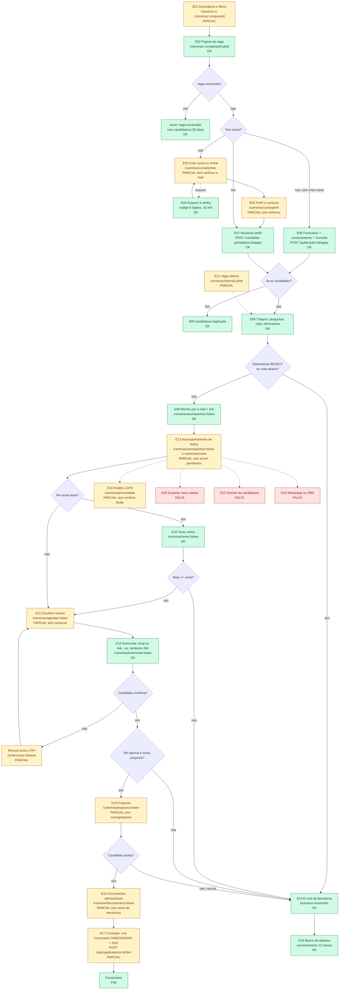

# Recrutamento e Selecao: fluxo do CANDIDATO (descoberta ate contratacao)

Levantamento SOMENTE LEITURA do codigo em 2026-10-30. Nenhum codigo foi alterado.
Escopo lido: `apps/web/app/carreiras/**`, `apps/api/src/modules/jobs/**`, `apps/api/prisma/schema.prisma`.

Legenda: **OK** = funciona de ponta a ponta e tem teste. **PARCIAL** = existe, mas incompleto (o que falta esta dito). **FALTA** = nao existe.

Limites desta analise (honestidade): li os controllers, services e regras citados. Dos arquivos `*.spec.ts` li apenas os titulos dos `describe/it` de `recruitment-end-to-end.spec.ts`; os demais specs sao citados pelo nome e pela contagem de `it(` e **nao tive o conteudo conferido**. Nao rodei testes. Nao encontrei nenhum teste e2e de navegador (Playwright/Cypress) cobrindo `/carreiras` (busca por specs do web que citem `carreiras` retornou vazio; `apps/api/test` so tem e2e de Asaas).

## 1. Resumo

- 23 etapas avaliadas: **10 OK, 10 PARCIAL, 3 FALTA**.
- Base tecnica forte: tokens publicos de 32 caracteres (`recruitment-tokens.ts`), Turnstile + throttle + limitador por IP/e-mail/e-mail+vaga na candidatura, ClamAV fail-closed nos documentos admissionais, retencao LGPD com cron diario, banco de talentos com consentimento de 12 meses.
- Pontos que mais pesam: pedido LGPD sem verificar quem pede (e a exclusao e executada por padrao quando o RH responde), Turnstile "fail-open" se a chave nao estiver configurada, curriculo sem antivirus, candidato nao consegue remarcar/cancelar entrevista nem fazer contraproposta, pagina de acompanhamento nao leva as acoes pendentes.

## 2. Fluxo etapa a etapa

### E01. Descoberta de vagas e filtros: PARCIAL
- Tela: `/carreiras` (hub global, `_components/careers-catalog.tsx`) e `/carreiras/[companyId]` (so uma empresa).
- API: `GET /public/jobs` (catalogo), `GET /public/jobs/company/:companyKey` (`public-jobs.controller.ts`).
- Regra: so vagas `OPEN` e nao confidenciais (`availablePublicJob()` + `confidential:false`, `jobs.repository.ts` `publicJobsCatalog`). Salario oculto quando `salaryHidden`. Perguntas eliminatorias e regra de nota sao removidas do JSON publico (`toPublicJob`).
- Filtros (todos no navegador, sobre a lista inteira): texto sem acento, localizacao, empresa, modelo de trabalho, contrato, senioridade, favoritas (localStorage), paginacao de 12 por pagina.
- Protecao: rota publica sem Turnstile (leitura). Sem throttle especifico alem do global.
- E-mail: nenhum.
- Teste: `public-jobs.controller.spec.ts` (2 it), `public-jobs-policy.spec.ts`.
- Falta: busca/paginacao no servidor (a lista inteira baixa de uma vez), alerta de novas vagas, ordenacao por relevancia. Ha helper `JobPosting` schema.org em `_lib/public-jobs.ts:485` (uso na pagina da vaga nao confirmado por mim).

### E02. Pagina da vaga: OK
- Tela: `/carreiras/[companyId]/[jobId]` (`job-details.tsx`).
- API: `GET /public/jobs/:jobId` (`publicJobById`).
- Regra: vaga encerrada ha menos de 30 dias continua visivel com `closed:true, acceptsApplications:false` e aviso "Esta vaga foi encerrada" (`jobs.service.ts` `publicJobById`); depois disso 404.
- Estados: OPEN / encerrada recente / 404.
- Teste: `public-jobs.controller.spec.ts`, `job-lifecycle.spec.ts`.

### E03. Criar conta e entrar: PARCIAL
- Tela: `/carreiras/conta/entrar` (modos login, register, forgot, reset em `login-form.tsx`). Area logada em `/carreiras/conta`.
- API: `POST /candidate-portal/auth/register` (Turnstile, 5/min), `POST .../auth/login` (Turnstile, 10/min), `POST .../auth/logout`, `GET /candidate-portal/me`.
- Regra: senha validada por `passwordProblem`; hash scrypt; sessao de 30 dias (`CandidateSession.tokenHash`, so o hash e gravado); bloqueio por falhas (`failedLoginCount` / `lockedUntil`, `LOGIN_MAX_FAILURES`); mensagem generica "E-mail ou senha incorretos".
- E-mail: nenhum no cadastro.
- Teste: `candidate-account.service.spec.ts` (21 it), `candidate-account.rules.spec.ts`.
- Falta: **nao ha verificacao de e-mail no cadastro**. `register` cria a conta e ja inicia sessao; `verifiedAt` so e preenchido no `resetPassword`. Consequencia: o pre-preenchimento da admissao exige `verifiedAt` (`jobs.repository.ts` hire), entao quem nunca redefiniu a senha nao tem o beneficio. Tambem nao ha login social nem MFA.

### E04. Recuperar senha: OK
- Tela: modos `forgot` e `reset` em `/carreiras/conta/entrar`.
- API: `POST /candidate-portal/auth/forgot-password` (Turnstile, 5/min), `POST .../auth/reset-password` (10/min).
- Regra: codigo de 6 digitos, validade 10 min, maximo 5 tentativas por codigo, limite de codigos por janela, resposta sempre `{sent:true}` (nao revela se o e-mail existe). Reset zera bloqueio e marca `verifiedAt`.
- E-mail: `candidatePasswordResetEmail` (codigo e minutos).
- Teste: `candidate-account.service.spec.ts`.

### E05. Perfil e curriculo: PARCIAL
- Tela: `/carreiras/conta/perfil` (`profile-form.tsx`).
- API: `GET/PUT /candidate-portal/me`, `PUT /candidate-portal/me/resume` (10/min), `GET /candidate-portal/cep/:cep`, `DELETE /candidate-portal/me`.
- Regra: CPF validado (`isValidCpf`), data de nascimento, CNH, escolaridade, experiencias, habilidades. Curriculo: **somente PDF ou DOCX, maximo 5 MB**, tipo verificado pelo conteudo (`inspectFile`, assinatura binaria, protecao contra zip-bomb), nome sanitizado, gravado em `candidates/{accountId}/{uuid}.ext`; o anterior e removido.
- Consentimentos no perfil: `consent` (grava `consentAt`/`consentVersion`), `talentPoolConsent`, `admissionShareConsent`.
- Teste: `candidate-account.service.spec.ts`.
- Falta: **curriculo nao passa pelo ClamAV**. `CandidateDocumentScanner` so e usado em `recruitment-documents.service.ts`; nem `saveResume` nem `JobsService.apply` o chamam. Hoje so ha validacao de tipo real e limite de tamanho.

### E06. Candidatura publica (formulario): OK
- Tela: formulario em `/carreiras/[companyId]/[jobId]` (campos nome, e-mail, telefone, LinkedIn, apresentacao, curriculo, perguntas da vaga, diversidade opcional, checkbox de consentimento, `TurnstileWidget`).
- API: `POST /public/jobs/:jobId/apply` (multipart, Turnstile, throttle 5/min).
- Regras: consentimento obrigatorio (`@Equals(true)` em `ApplyJobDto`); honeypot `website`; curriculo obrigatorio PDF/DOCX ate 5 MB; limitador `apply-abuse.ts` (20 por IP/10 min, 10 por e-mail/h, 3 por e-mail+vaga/h, Redis com fallback em memoria); revalida a vaga dentro da transacao (vaga fechada no meio nao recebe); trava advisory por `empresa:email`; **duplicidade**: `@@unique([companyId,candidateId,jobId])` + checagem, responde 409 "Voce ja se inscreveu nesta vaga"; diversidade (`CandidateDiversity`) e opcional.
- Estados: cria `Application.status=APPLIED` (ou `REJECTED` se eliminatoria com acao REJECT).
- Teste: `jobs.service.spec.ts`, `jobs-bugfixes.spec.ts`, `application-source.spec.ts`, `public-jobs.controller.spec.ts`, `recruitment-hardening.spec.ts`.
- Observacoes de risco: (a) se o e-mail ja existe como `Candidate` da empresa, `name`, `phone` e `linkedinUrl` sao sobrescritos pelos dados de quem se candidata agora (sem verificar posse do e-mail); (b) o 409 confirma que aquele e-mail ja se candidatou (enumeracao leve).

### E07. Candidatura reutilizando perfil salvo: OK
- Tela: bloco "reutilizar meus dados" em `job-details.tsx` (`submitReuse`).
- API: `POST /candidate-portal/jobs/:jobId/apply` (5/min, logado).
- Regra: exige consentimento e perfil minimo (nome, telefone, curriculo); reaproveita o curriculo salvo e chama o mesmo `JobsService.apply` (mesmas regras de duplicidade, triagem e vaga encerrada); marca `CandidateInvite` como `APPLIED`.
- Teste: `candidate-account.service.spec.ts`.

### E08. Triagem (perguntas, nota, eliminatoria): OK
- Tela: perguntas aparecem no formulario da vaga.
- Regra (`recruitment-rules.ts`, `JobsService.apply`): validacao de formato por tipo, `required`, regra de nota (`scoreRule`) somando `Application.score`, eliminatoria (`knockout.acceptValues`, `min/max` para NUMBER) com acao `FLAG` (apenas marca `knockedOut`) ou `REJECT` (move para etapa REJECTED). Nota minima por vaga (`screeningMinScore`, `screeningAction`).
- Candidato nao ve que a pergunta era eliminatoria (campos `knockout` e `scoreRule` removidos do JSON publico).
- E-mail: se reprovado automaticamente, a devolutiva sai **24 h depois** (`InterviewFollowupService.sendDelayedKnockoutFeedback`, cron `10 * * * *`).
- Teste: `screening-v2.spec.ts`, `recruitment-rules.spec.ts`.

### E09. Recibo da candidatura e protocolo: OK
- Regra (`RecruitmentPrivacyService.afterApply`): gera `trackingToken` (40 hex), grava `consentVersion` (`PRIVACY_VERSION=2026-10`), `retentionUntil` (padrao 12 meses, configuravel 3 a 60), sinaliza telefone duplicado ao RH, guarda diversidade. Nunca derruba a candidatura.
- E-mail: `applicationReceivedEmail` com link de acompanhamento e link de privacidade (liga/desliga em `RecruitmentSetting.receiptEmail`, padrao ligado).
- Teste: `recruitment-privacy.spec.ts`.

### E10. Teste online (tecnico e comportamental): OK
- Tela: `/carreiras/teste/[token]` (`client.tsx`).
- API: `GET /public/recruitment/assessment/:token` (30/min), `POST .../start` e `POST .../submit` (10/min).
- Regra (`assessments.service.ts`): link de 1 a 14 dias (padrao 3); perguntas so aparecem depois de "Comecar" (o tempo conta dali); tempo limite 5 a 240 min com tolerancia (`GRACE_MS`); correcao com pesos; nota de corte; `autoReject` reprova sozinho abaixo da nota; resposta unica (reivindicacao atomica); comportamental com 16 situacoes e perfil.
- Estados do convite: SENT, STARTED, COMPLETED, EXPIRED (calculado na leitura, nao gravado), CANCELED.
- E-mail: `assessmentInviteEmail`; o envio pode ser manual (`POST /jobs/applications/:id/assessments`) ou automatico por etapa (workflow `SEND_TECHNICAL_ASSESSMENT` / `SEND_BEHAVIORAL_ASSESSMENT`, com retentativa a cada 5 min ate 5 vezes).
- Teste: `recruitment-end-to-end.spec.ts` (bloco "testes online" e "teste: envio e resposta").
- Menor: sem lembrete antes de vencer; candidato nao ve a propria nota.

### E11. Agendamento da entrevista pelo link: PARCIAL
- Tela: `/carreiras/agendar/[token]` (`client.tsx`).
- API: `GET/POST /public/recruitment/slots/:token` (30 e 10/min); RH cria com `POST /jobs/applications/:id/slot-offers` e cancela em `.../slot-offers/:offerId/cancel`.
- Regra: de 1 a 8 horarios futuros; validade 1 a 14 dias, nunca depois do ultimo horario; nova oferta cancela a pendente; so aparecem horarios com mais de 1 h de folga e **sem conflito com a agenda de quem ofereceu** (`ManagementEvent` do responsavel); reserva atomica (`status PENDING -> BOOKED`, so um clique vence); ao marcar: cria `ApplicationInterview`, marca `candidateResponse=CONFIRMED`, move a candidatura para a etapa de entrevista, avisa o RH.
- Estados da oferta: PENDING, BOOKED, CANCELED, EXPIRED (calculado).
- E-mail: `interviewSlotsEmail` (oferta) e `candidateInterviewEmail` com .ics na confirmacao.
- Teste: `interview-scheduling.spec.ts` (6 it), `recruitment-end-to-end.spec.ts` (bloco "autoagendamento e confirmacao").
- Falta: **depois de marcado, o candidato nao remarca nem cancela pelo link**. So pode recusar em E12, e o RH precisa ofertar novos horarios manualmente. Nao ha "pedir outros horarios". O conflito considera apenas um responsavel (quem criou a oferta), nao o entrevistador informado.

### E12. Entrevista: local/link, confirmacao e lembrete: OK
- Tela: `/carreiras/entrevista/[token]` (`client.tsx`).
- API: `GET/POST /public/recruitment/interview/:token`.
- Onde fica o local/link: `ApplicationInterview.mode` PRESENCIAL (usa `location`, gera link de mapa) ou ONLINE (usa `meetingUrl`, exige https, detecta provedor via `meetingProvider`). Aparece na pagina, no e-mail e no .ics (`interview-rules.ts`), com link "Adicionar ao Google Agenda".
- Regra: candidato confirma ou recusa com motivo ate 500 caracteres; nao responde se ja passou (410) ou se processo encerrado; recusa avisa o RH com prioridade alta e marca a agenda ("Candidato nao pode").
- Lembrete: cron horario envia 1 vez a entrevistas nas proximas 24 h (convite com mais de 2 h, sem recusa), reservando `reminderSentAt` antes de enviar (sem duplicar entre servidores); .ics nao e reenviado.
- E-mails: `candidateInterviewEmail` (agendada e lembrete), `candidateInterviewCanceledEmail` (cancelada, .ics METHOD:CANCEL).
- Teste: `interview-rules.spec.ts`, `interview-scheduling.spec.ts`, `recruitment-end-to-end.spec.ts` (confirmacao, recusa, passado, lembrete sem duplicar).

### E13. Acompanhamento de status: PARCIAL
- Telas: `/carreiras/acompanhar/[token]` (por link) e `/carreiras/conta` (logado, `applications-view.tsx`: etapas, proxima entrevista, funil com "menos de 5").
- API: `GET /public/candidate-status/:token` (30/min); `GET /candidate-portal/applications`.
- Textos mostrados ao candidato (`STAGE_LABEL_FOR_CANDIDATE`): APPLIED "Candidatura recebida"; SCREENING "Em analise pelo RH"; INTERVIEW "Em fase de entrevistas"; OFFER "Proposta em andamento"; HIRED "Processo concluido: voce foi selecionado(a)"; REJECTED "Processo encerrado para esta vaga". Mais o nome da etapa e linha do tempo (so eventos APPLIED, STAGE_CHANGED, REJECTED). Etapas do pipeline podem ter `candidateLabel`.
- Protecao: token de 40 hex; candidatura anonimizada devolve 404; vaga confidencial nao exibe funil.
- Teste: `recruitment-privacy.spec.ts`.
- Falta: a pagina **nao mostra acoes pendentes** (responder teste, escolher horario, ver proposta, enviar documentos); esses links existem so no e-mail original. O token de acompanhamento **nao expira** (so deixa de valer na anonimizacao). Linha do tempo nao inclui entrevista, teste ou proposta. Conta logada mostra so entrevista futura.

### E14. Devolutiva ao candidato reprovado: OK
- Regra (`afterRejected`): ao mover para REJECTED envia e-mail uma vez (`REJECTION_EMAIL_SENT`), mensagem personalizavel por empresa (`rejectionMessage`), liga/desliga (`rejectionEmail`); retentativa por ate 7 dias se o provedor falhar; reprovado por eliminatoria espera 24 h; candidato anonimizado nao recebe. Motivo interno padronizado (`REJECTION_CODES`) nao e enviado ao candidato.
- E-mail: `applicationRejectedEmail`.
- Teste: `recruitment-privacy.spec.ts`, `recruitment-hardening.spec.ts`.
- Menor: devolutiva e a mesma para todos (sem feedback construtivo individual).

### E15. Proposta (aceitar, recusar, contraproposta, validade): PARCIAL
- Tela: `/carreiras/proposta/[token]` (`client.tsx`).
- API: `GET/POST /public/recruitment/offer/:token`; interno: `POST /jobs/applications/:id/offers`, `offers/:id/approve`, `/return`, `/send`, `/cancel`.
- Fluxo interno: PENDING_APPROVAL -> APPROVED -> SENT; aprovador diferente do criador (`canApproveOffer`); so envia se o e-mail sair; move para a etapa OFFER.
- Regra do candidato: aceita ou recusa uma unica vez (reivindicacao atomica); recusa aceita motivo; validade `expiresAt` (padrao 7 dias, alterada no envio); vencida devolve 410; rascunho nunca aparece; marca `viewedAt`; RH recebe notificacao prioritaria.
- Estados: PENDING_APPROVAL, APPROVED, SENT, ACCEPTED, DECLINED, CANCELED, EXPIRED.
- E-mail: `jobOfferEmail` (com link e prazo).
- Teste: `recruitment-end-to-end.spec.ts` (bloco "proposta: aprovacao interna", aceite unico, vencida).
- Falta: **contraproposta** (nao existe campo nem tela); `EXPIRED` nunca e gravado (so calculado na leitura, sem cron nem aviso ao RH); sem lembrete antes de vencer; sem aceite com valor probatorio (assinatura, IP, hash dos termos, PDF da proposta); e-mail ao candidato confirmando o aceite/recusa nao existe.

### E16. Envio de documentos admissionais: PARCIAL
- Tela: `/carreiras/documentos/[token]` (`upload.tsx`).
- API: `GET /public/candidate-documents/:token` (30/min), `POST .../:token/upload` (10/min); interno: criar link, revisar, selecionar e encaminhar (`recruitment-documents.controller.ts`).
- Regra: token de 43 caracteres, **so o SHA-256 e gravado**; validade padrao 7 dias (RH escolhe 1 a 30), link de contratacao 14 dias; revogavel; tipos reais PDF, PNG, JPEG ate 5 MB; **ClamAV fail-closed em producao**; novo envio substitui o anterior (`supersededAt`); documento aprovado nao pode ser trocado; pagina mostra status e motivo de devolucao por item; encaminhamento exige TODO item aprovado.
- E-mail: `candidateDocumentsEmail` (link) e `candidateHiredEmail` (parabens com link e kit CLT ou PJ).
- Teste: `recruitment-documents.service.spec.ts` (14 it), `recruitment-documents.rules.spec.ts`, `candidate-documents-security.spec.ts`, `hire-documents-email.spec.ts`.
- Falta: **o candidato nao recebe e-mail quando um documento e devolvido ou aprovado** (`review` so grava e audita), entao depende de voltar ao link; o link so e criado automaticamente **depois** de contratar (`sendHireWelcome`), nao ha coleta pre-proposta automatica; o link some ao encaminhar (candidato nao ve que acabou).

### E17. Admissao e virada para funcionario: PARCIAL
- Tela: so interna (botao Contratar na ficha). O candidato recebe apenas o e-mail e o link de documentos.
- API: `POST /jobs/applications/:id/hire` (departamento, tipo de contrato e data de admissao obrigatorios).
- Regra (`jobs.repository.ts` `hire`): transacao cria `Employee` com status `ONBOARDING`, vinculo `originCandidateId`, registro de ASO admissional (`SCHEDULED` se houver clinica padrao, senao `PENDING`), anexa o curriculo, move a candidatura para HIRED (`Candidate.status` idem), registra evento. Idempotente (`alreadyHired`). Pre-preenche CPF, endereco e formacao da conta do candidato **somente se** `admissionShareConsent` e `verifiedAt` (ver E03); CPF repetido nao e copiado.
- E-mail: `candidateHiredEmail` disparado com `void` (sem aguardar nem repetir se falhar; evento `HIRED_EMAIL` diz se saiu).
- Teste: `hire-documents-email.spec.ts`, `jobs.service.spec.ts`.
- Falta: nao encontrei validacao de que existe proposta ACEITA antes de contratar; sem area do candidato/novo funcionario para acompanhar a admissao (assinatura de contrato, ASO, e-social) alem do link de documentos; fire-and-forget do e-mail.

### E18. Banco de talentos e consentimento: OK
- Tela: opcao no perfil (`/carreiras/conta/perfil`); convites aparecem em `/carreiras/conta`.
- API: `GET /talent-pool` (RH), `POST /talent-pool/:id/invite`, `POST /candidate-portal/invites/:inviteId/decline`.
- Regra: so entra com `talentPoolConsentAt`; vale 12 meses (`TALENT_CONSENT_MONTHS`) e depois e zerado automaticamente (`talent-pool.service.ts`); RH nao ve e-mail/telefone, contato pela plataforma; revogar o consentimento tira do banco; candidato recusa convite.
- E-mail: `candidateInviteEmail`.
- Teste: `talent-pool.service.spec.ts`.
- Obs.: candidatura pela via publica (sem conta) nao oferece opt-in no banco de talentos; so a conta oferece.

### E19. LGPD: pedidos do titular, exclusao e retencao: PARCIAL
- Tela: `/carreiras/privacidade` (`request-form.tsx`); exclusao da conta no perfil.
- API: `POST /public/candidate-requests` (5/min), `DELETE /candidate-portal/me`; interno: `GET /recruitment-privacy/requests`, `.../requests/:id/export`, `.../requests/:id/answer`, `GET/PUT .../settings`.
- Regra: tipos ACCESS, CORRECTION, DELETION; resposta sempre generica; um pedido aberto por empresa/e-mail/tipo; RH responde e, em DELETION, `anonymizeByEmail` roda por padrao (`perform !== false`), apagando curriculo, respostas, notas e documentos e preservando a candidatura sem identificacao para metricas; contratados sao preservados (viram funcionarios); cron `30 3 * * *` anonimiza quem passou da retencao. `DELETE /candidate-portal/me` apaga conta, sessoes, codigos e curriculo da conta, **mas mantem as candidaturas ja enviadas** (decisao documentada no codigo).
- E-mail: `candidateRequestAnsweredEmail` ao titular.
- Teste: `recruitment-privacy.spec.ts`, `candidate-documents-security.spec.ts`.
- Falta (risco): **o pedido nao verifica que quem pede e o dono do e-mail** e o formulario nao usa Turnstile (so throttle 5/min). Qualquer pessoa abre um pedido de exclusao para o e-mail de outra e, ao responder com o padrao, o RH apaga os dados reais. Sem prazo/SLA visivel (LGPD pede resposta em ate 15 dias para acesso), sem fila de vencidos, sem confirmacao de que a exclusao de conta nao apaga candidaturas.

### E20. Portabilidade e exportacao dos dados pelo candidato: FALTA
- Existe `GET /recruitment-privacy/requests/:id/export` (JSON, **somente RH**, por empresa). Nao ha endpoint nem botao para o candidato baixar os proprios dados da conta (perfil, candidaturas, respostas) em formato estruturado, nem consolidado entre empresas.

### E21. Vagas internas (funcionario): PARCIAL
- Tela: `/carreiras/interna/[jobId]` (`client.tsx`, com `TurnstileWidget`).
- API: `GET /public/internal-jobs/:jobId` (30/min), `POST /public/internal-jobs/:jobId/apply` (Turnstile, 5/min); logado: `GET /internal-jobs`, `GET /internal-jobs/lookup` (matricula), `POST /internal-jobs/:jobId/apply`.
- Regra: candidatura de funcionario identificada pela matricula (`Application.employeeId`).
- Teste: nao encontrei spec dedicado a `internal-jobs.service.ts`; cobertura possivel em `rh-rs-access.spec.ts`/`job-scope.spec.ts` (nao conferido). Detalhes de regras (gestor ciente, vagas confidenciais) nao foram lidos a fundo.

### E22. Desistir da candidatura: FALTA
- Nao existe endpoint nem botao para o candidato retirar a candidatura. So ha recusar convite do banco de talentos, recusar entrevista e recusar proposta. Quem desiste hoje precisa avisar o RH fora da plataforma.

### E23. Canais alem de e-mail (WhatsApp/SMS/push) ao candidato: FALTA
- Toda comunicacao ao candidato e por e-mail (`MailService`). Se o e-mail cai no spam, o candidato perde convite, horarios e proposta. As notificacoes internas (`RecruiterNotifierService`) sao so para o RH.

## 3. Protecoes e links publicos (consolidado)

| Item | Mecanismo | Evidencia |
|---|---|---|
| Anti-bot | Turnstile em apply, register, login, forgot, interna. Desligado automaticamente se `TURNSTILE_SECRET_KEY` nao existir (fail-open) | `common/turnstile/turnstile.guard.ts` |
| Limite de tentativas | Throttler por rota + `ApplyLimiter` (IP, e-mail, e-mail+vaga) + bloqueio de login por falhas + 5 tentativas por codigo de reset | `apply-abuse.ts`, `candidate-account.service.ts` |
| Tokens de e-mail (entrevista, horarios, proposta, teste) | 24 bytes aleatorios base64url = 32 chars; validados por regex; **valor bruto guardado no banco**; expiracao existe para horarios, proposta e teste; **entrevista nao expira** (so fica sem resposta apos a data) | `recruitment-tokens.ts`, schema |
| Token de documentos | 32 bytes, so SHA-256 no banco, expiracao + revogacao | `recruitment-documents.rules.ts` |
| Token de acompanhamento | 20 bytes hex, bruto no banco, sem expiracao | `recruitment-privacy.ts` |
| LGPD | Consentimento obrigatorio com versao, retencao configuravel, anonimizacao por cron, banco de talentos com validade, diversidade opcional | `recruitment-privacy.service.ts` |
| Arquivos | Tipo real por assinatura; ClamAV so nos documentos admissionais | `file-validation.ts`, `candidate-document-scanner.service.ts` |
| Exposicao minima | Paginas publicas mostram so o primeiro nome (`firstName`) | `recruitment-tokens.ts` |

## 4. Diagrama do fluxo

## 5. Lista de lacunas priorizada

Esforco em horas de desenvolvimento + teste, estimativa propria (nao medida).

### P0: bloqueia lancamento

| ID | Lacuna | Etapa | Esforco | Detalhe |
|---|---|---|---|---|
| RS-C-01 | Pedido LGPD sem verificar o titular e sem Turnstile; exclusao executada por padrao | E19 | 8 h | Enviar link/codigo de confirmacao ao e-mail do pedido antes de abrir `CandidateRequest` (ou so processar apos confirmar), adicionar `TurnstileGuard` em `POST /public/candidate-requests`, exibir prazo. |
| RS-C-02 | Turnstile fail-open se a chave nao estiver definida | E03, E06, E19 | 2 h | Falhar no boot em `NODE_ENV=production` quando `TURNSTILE_SECRET_KEY` faltar (ou alarme), com teste. |
| RS-C-03 | Curriculo (candidatura publica e conta) sem antivirus | E05, E06 | 4 h | Chamar `CandidateDocumentScanner.assertClean` em `JobsService.apply` e `CandidateAccountService.saveResume` (fail-closed em producao). |

### P1

| ID | Lacuna | Etapa | Esforco |
|---|---|---|---|
| RS-C-04 | Candidato remarcar/cancelar entrevista e pedir outros horarios pelo link | E11, E12 | 12 h |
| RS-C-05 | E-mail ao candidato quando documento e aprovado ou devolvido (com motivo e link) | E16 | 4 h |
| RS-C-06 | Pagina de acompanhamento com acoes pendentes (teste, horarios, proposta, documentos) e linha do tempo completa | E13 | 10 h |
| RS-C-07 | Contraproposta do candidato (campos, tela, fluxo de nova aprovacao) | E15 | 16 h |
| RS-C-08 | Gravar `EXPIRED` (cron) e lembrar antes de vencer: proposta, teste, horarios | E10, E11, E15 | 6 h |
| RS-C-09 | Verificacao de e-mail no cadastro (codigo ou link) e `verifiedAt` real | E03 | 8 h |
| RS-C-10 | Autoatendimento: exportar meus dados (JSON/CSV) e excluir conta com esclarecimento sobre candidaturas | E19, E20 | 14 h |
| RS-C-11 | Desistir da candidatura (botao na conta e no acompanhamento, aviso ao RH) | E22 | 6 h |
| RS-C-12 | Nao sobrescrever `name`/`phone` de candidato existente sem prova de posse do e-mail; evitar enumeracao no 409 | E06 | 5 h |
| RS-C-13 | Exigir proposta ACEITA (ou justificativa) para contratar; enviar e-mail de contratacao com retentativa em vez de `void` | E17 | 5 h |
| RS-C-14 | Testes e2e de navegador do fluxo (candidatar, escolher horario, aceitar proposta, enviar documento) | todas | 20 h |

### P2

| ID | Lacuna | Etapa | Esforco |
|---|---|---|---|
| RS-C-15 | Busca e paginacao no servidor, ordenacao e alerta de novas vagas | E01 | 16 h |
| RS-C-16 | Expirar/rotacionar `trackingToken` e token de entrevista; guardar hash em vez do valor bruto | tokens | 6 h |
| RS-C-17 | Aceite da proposta com valor probatorio (IP, data, hash dos termos, PDF) e e-mail de confirmacao | E15 | 10 h |
| RS-C-18 | Opt-in do banco de talentos na candidatura sem conta | E18 | 4 h |
| RS-C-19 | WhatsApp/SMS para convites e lembretes | E23 | 24 h |
| RS-C-20 | Mostrar resultado/devolutiva do teste ao candidato e feedback individual na reprovacao | E10, E14 | 8 h |
| RS-C-21 | Revisar vagas internas: spec dedicado e regras de ciencia do gestor | E21 | 8 h |
| RS-C-22 | Login social e MFA opcional na conta do candidato | E03 | 16 h |

Total estimado: P0 14 h, P1 106 h, P2 92 h.

## 6. Relatorio final

- Etapas: **10 OK, 10 PARCIAL, 3 FALTA** (23 avaliadas).
- As 8 lacunas mais importantes:
  1. RS-C-01 Pedido LGPD sem verificar titular, com exclusao padrao (P0, 8 h).
  2. RS-C-02 Turnstile fail-open sem chave em producao (P0, 2 h).
  3. RS-C-03 Curriculo sem ClamAV (P0, 4 h).
  4. RS-C-04 Sem remarcar/cancelar entrevista pelo candidato (P1, 12 h).
  5. RS-C-06 Acompanhamento sem acoes pendentes (P1, 10 h).
  6. RS-C-07 Sem contraproposta (P1, 16 h).
  7. RS-C-10 Sem exportar/portar dados pelo candidato (P1, 14 h).
  8. RS-C-09 Sem verificacao de e-mail na conta (P1, 8 h).
