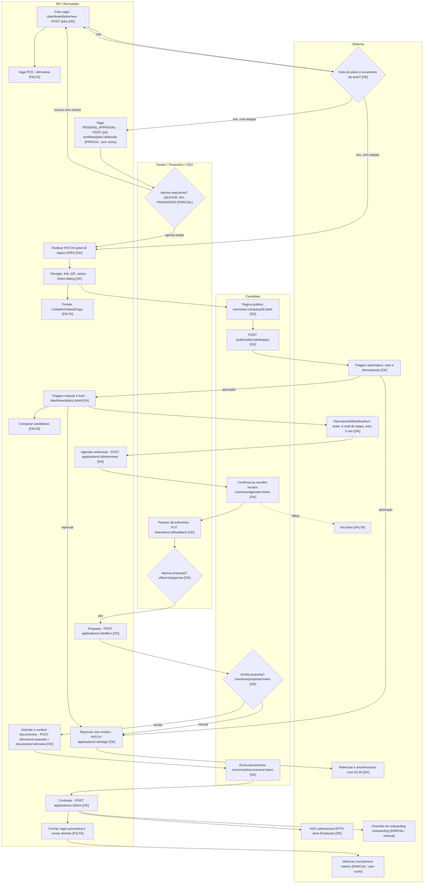

# Recrutamento e Seleção: fluxo do RH/Recrutador (da divulgação ao fechamento)

Levantamento somente leitura, com evidência de código. Data-base: 2026-10-30.
Legenda: OK = existe e coberto; PARCIAL = existe com falha ou sem teste/UI; FALTA = não existe.
Caminhos abaixo são relativos a `apps/api/src/modules/jobs/` (API) e `apps/web/app/[tenant]/dashboard/jobs/` (web), salvo indicação.

## 1. Permissões por perfil (resumo)

Fonte: `apps/web/app/lib/role-access.ts` (linhas 24-28) e decorators `@Roles` nos controllers.

| Capacidade | DEV/ADMIN | RH | RH_RS | GESTOR | CEO | CONTABIL | CONSULTA |
|---|---|---|---|---|---|---|---|
| Acessar módulo (`recruitmentAccess`) | sim | sim | sim | sim | não | não | não |
| Criar/editar/duplicar/excluir vaga (`jobs.controller.ts` 43-90) | sim | sim | sim | não (só acompanha) | não | não | não |
| Atribuir recrutadores (`:id/recruiters`) | sim | sim | não | não | não | não | não |
| Configurar funil/etapas (`recruitmentConfigure`) | sim | sim | não | não | não | não | não |
| Conduzir processo (`recruitmentConduct`) | sim | sim | sim | parcial | não | não | não |
| Contratar (`POST applications/:id/hire`) | sim | sim | NÃO (a API recusa) | sim | não | não | não |
| Aprovar requisição: etapa GESTOR / RH / FINANCEIRO (`job-workflow.ts` STEP_ROLES) | A,D / A,D,RH / A,D | RH | não | GESTOR | FINANCEIRO | FINANCEIRO | não |
| Orçamento por área (GET) | sim | sim | não | não | sim | sim | não |

Escopo por vaga: `job-scope.service.ts` (`assertJob`, `assertApplication`) limita RH_RS/GESTOR às vagas em que são responsáveis. Teste: `job-scope.spec.ts`, `job-workflow-access.spec.ts`, `rh-rs-access.spec.ts`.
CEO, CONTABIL e CONSULTA não acessam o módulo, exceto CEO/CONTABIL na aprovação financeira e no orçamento.

## 2. Etapa a etapa

| # | Etapa | Status | Tela | Endpoint | Regra / estados | Notificação | Permissão | Teste |
|---|---|---|---|---|---|---|---|---|
| 1 | Criar vaga (wizard 5 passos: Tipo e cargo, Detalhes, Triagem, Etapas e avaliação, Publicar) | OK | `new/page.tsx`, `_components/job-wizard.tsx`, `[jobId]/edit/page.tsx` | `POST /jobs`, `PATCH /jobs/:id` | Campos: título, descrição, requisitos, benefícios, local, workMode, tipo de contrato (CLT/PJ/Estágio/Temporário/Jovem aprendiz), senioridade, salário min/max/oculto, vagas (`openings`), prazo (`deadline`), interna, confidencial. Cota mensal do plano (`assertJobQuota`, erro `JOB_QUOTA_REACHED`). Rollback se falhar atribuir responsável | nenhuma | DEV, ADMIN, RH, RH_RS | `jobs.service.spec.ts`, `jobs-bugfixes.spec.ts` |
| 1a | Modelos de perguntas/vagas | OK | `job-library.ts`, wizard | `GET/POST /job-workflow/templates`, `POST templates/:id/use` | Modelo salvo por empresa, remoção só RH/ADMIN | nenhuma | RH, RS | sem spec dedicado em `job-templates.service.ts` |
| 1b | Marcar vaga PCD / afirmativa | FALTA | n/a | n/a | PCD existe só como dado de diversidade opcional do candidato (`apply-job.dto.ts`, `afterApply`), não como atributo da vaga (sem cota PCD, sem selo na vaga, sem filtro) | n/a | n/a | n/a |
| 2 | Aprovação interna da requisição (gestor, RH, financeiro) | PARCIAL | `_components/workflow-settings.tsx`, `_components/approvals-panel.tsx` | `GET/PUT /job-workflow/steps`, `GET /job-workflow/pending`, `GET jobs/:id/approvals`, `POST jobs/:id/decide`, `GET/PUT budgets` | Etapas configuráveis na ordem fixa GESTOR, RH, FINANCEIRO. Só vaga nova/rascunho indo para OPEN passa por aprovação (`needsApproval`). Todas aprovam: abre (`OPEN`). Qualquer recusa (exige motivo): volta a `DRAFT`. Orçamento de vagas por área bloqueia (`HEADCOUNT_EXCEEDED`). Etapas sempre em série | NENHUMA: `job-workflow.service.ts` não usa `RecruiterNotifierService`; aprovador só vê a pendência ao abrir o painel (`/pending`). Solicitante também não é avisado do resultado | ver §1 | `job-workflow.spec.ts` (só regras puras), `job-workflow-access.spec.ts`. `decide()`/`startApproval` sem teste de serviço |
| 3 | Publicar | OK | `page.tsx` (cards com ações), wizard passo 5 | `PATCH /jobs/:id {status:'OPEN'}` | Rascunho para OPEN (ou PENDING_APPROVAL). Pública só se aberta, dentro do prazo, não confidencial e empresa ativa (`availablePublicJob`) | nenhuma | RH, RS | `job-lifecycle.spec.ts`, `public-jobs-policy.spec.ts` |
| 4 | Despublicar (pausar) / retomar | OK | `page.tsx` linhas 158-160 | `PATCH /jobs/:id {status:'PAUSED'|'OPEN'}` | Só OPEN pausa; pausada volta sem prazo e sem consumir cota | nenhuma | RH, RS | `job-lifecycle.spec.ts` |
| 5 | Encerrar / marcar preenchida / reativar | PARCIAL | `page.tsx` | `PATCH /jobs/:id {status:'CLOSED'|'FILLED'|'OPEN'}`, `DELETE /jobs/:id?mode=archive|permanent` | `statusChange()` grava `closedAt`; reativação por 30 dias (`REACTIVATION_DAYS`) sem contar cota; depois só duplicar; exclusão permanente bloqueada se houver contratado e auditada (`JOB_DELETED_PERMANENTLY`). Pública mostra aviso "encerrada" por 30 dias. FALTA: encerramento automático quando `hired >= openings` e ao vencer `deadline` (só deixa de aceitar candidatos, status continua OPEN) | nenhuma | RH, RS | `job-lifecycle.spec.ts`, `jobs-bugfixes.spec.ts` |
| 6 | Duplicar vaga | OK | `page.tsx` | `POST /jobs/:id/duplicate` | Cópia em `DRAFT` com perguntas e critérios, sufixo "(cópia)", consome cota. Não copia recrutadores adicionais nem prazo | nenhuma | RH, RS | `jobs.service.spec.ts` (parcial) |
| 7 | Recrutadores por vaga | OK | `_components/job-recruiters.tsx` | `GET /jobs/recruiters/eligible`, `GET/PUT /jobs/:id/recruiters` | Criador vira responsável (`assignCreator`); RH/ADMIN definem; quem recruta não define o próprio escopo | e-mail/in-app aos responsáveis em eventos (via `recruiter-notifier.service.ts`) | DEV, ADMIN, RH | `job-scope.spec.ts` |
| 8 | Divulgação: página pública, link, QR, cartaz, compartilhar | OK | `_components/share-dialog.tsx`, `poster-html.ts`; público `apps/web/app/carreiras/**` | `GET /public/jobs`, `/public/jobs/company/:key`, `/public/jobs/:jobId` | Link `/carreiras/{companyId}/{jobId}`; interna usa `/carreiras/interna/:id`; QR (lib `qrcode`), cartaz imprimível, botão LinkedIn de compartilhamento, rastreio de origem (`trackedJobUrl`, `application-source.ts`) | n/a | RH, RS | `public-jobs.controller.spec.ts`, `application-source.spec.ts`, `public-jobs-policy.spec.ts` |
| 8a | SEO | PARCIAL | `carreiras/_lib/public-jobs.ts` `jobPostingJsonLd` (schema.org JobPosting, Google for Jobs) injetado em `job-details.tsx` | n/a | JSON-LD existe, mas é injetado no cliente (`typeof window`) e NÃO há `sitemap.xml`/`robots.txt` com as vagas (nenhum arquivo `sitemap*` em `apps/web`) | n/a | n/a | sem teste |
| 8b | Portais externos (LinkedIn, Indeed, Gupy, Catho, Vagas.com) | FALTA | n/a | n/a | Nenhuma integração/publicação. Existem só o botão "compartilhar no LinkedIn" (URL de share) e o campo opcional "LinkedIn do candidato". JSON-LD é o único caminho indireto (Google for Jobs) | n/a | n/a | n/a |
| 9 | Recebimento de candidaturas | OK | `carreiras/[companyId]/[jobId]/job-details.tsx`; candidato logado `carreiras/conta/**` | `POST /public/jobs/:jobId/apply` (multipart), `POST /candidate-portal/jobs/:jobId/apply` | Currículo PDF/DOCX até 5 MB com validação por assinatura binária, honeypot `website`, Turnstile/throttle, duplicidade por e-mail (409), consentimento LGPD, `trackingToken` de acompanhamento, retenção calculada. Antivírus: `candidate-document-scanner.service.ts` | e-mail de recibo ao candidato (`receiptEmail`, configurável). Recrutador NÃO é avisado de nova candidatura (nenhum `notifier.notify` em `apply`) | público | `jobs.service.spec.ts`, `recruitment-hardening.spec.ts`, `candidate-documents-security.spec.ts`, `candidate-account.service.spec.ts` |
| 10 | Triagem automática (nota, eliminatórias, ranking) | OK | `_components/screening-editor.tsx` | `GET/PUT /jobs/:jobId/questions`, `GET/PUT :jobId/criteria` | Perguntas com `knockout` e `scoreRule`; `evaluateApplication` gera nota; abaixo de `screeningMinScore`, ação `screeningAction` (marcar ou rejeitar). Eliminada: rejeição automática opcional e devolutiva 24 h depois. Ordenação por nota na lista (`GET :jobId/applications`). Avaliação às cegas (`blind-evaluation.ts`) | e-mail de devolutiva atrasado (`sendDelayedKnockoutFeedback`) | RH, RS | `screening-v2.spec.ts`, `recruitment-rules.spec.ts`, `blind-evaluation.spec.ts` |
| 11 | Triagem manual (favoritar, notas, tags, filtros salvos, ações em lote, exportar) | OK | `[jobId]/page.tsx`, `_components/candidate-drawer.tsx`, `filters-bar.tsx`, `candidate-views.tsx` | `PATCH applications/:id/favorite`, `POST applications/:id/notes`, `PUT applications/:id/tags`, `GET/POST/DELETE tags`, `views`, `POST applications/bulk`, `GET :jobId/applications/export` | Kanban e tabela; filtros busca sem acento; CSV | nenhuma | RH, RS, GESTOR (leitura/avaliação) | `recruitment-stats.spec.ts`, `recruitment-rules.spec.ts` |
| 12 | Funil por etapas (mover, motivo de reprovação, histórico) | OK | `[jobId]/page.tsx`, `settings/page.tsx` (editor de pipeline) | `GET/PUT /jobs/pipeline`, `PATCH applications/:id/stage`, `GET applications/:id` | 11 etapas padrão (Inscritos a Reprovado). Reprovação exige motivo ou código (`REJECTION_CODES`). Etapa HIRED só via "Contratar". Pré-requisitos por automação (`assertAutomationPrerequisites`). Histórico em `ApplicationEvent` (STAGE_CHANGED, REJECTED, WORKFLOW_*). RH_RS não vê etapa Contratado | candidato: e-mail se `notifyCandidate` (`NOTIFY_STAGE_CHANGE`); reprovação: `afterRejected` envia e-mail se `rejectionEmail` ativo | RH, RS, GESTOR | `recruitment-end-to-end.spec.ts`, `recruitment-rules.spec.ts`, `rh-rs-access.spec.ts` |
| 12a | Motor de automação de etapa (`RecruitmentWorkflowRun`) | OK | n/a | interno (no `moveInTx`) | Ações: enviar teste comportamental/técnico, `SCHEDULE_INTERVIEW`, `PREPARE_OFFER`, `REQUEST_DOCUMENTS`, `COMPLETE_ADMISSION`, `NOTIFY_STAGE_CHANGE`. Estados PENDING, RUNNING, COMPLETED, WAITING, FAILED; idempotência por `applicationId:stageId:movedAt`; cron `*/5` reprocessa até 5 tentativas. Sem tela de monitoramento das execuções que falharam além do evento no histórico | e-mail do teste/etapa | sistema | sem `recruitment-workflow.service.spec.ts` (coberto indiretamente por `recruitment-end-to-end.spec.ts`) |
| 13 | Teste / avaliação online | OK | `[jobId]/teste/page.tsx`; candidato `carreiras/teste/[token]` | `GET/PUT :jobId/assessment`, `POST/GET applications/:id/assessments`, `POST .../cancel`, público `assessment/:token` (get/start/submit) | Técnico e comportamental, validade em dias (padrão 3), correção por peso | e-mail com link ao candidato; aviso ao recrutador ao concluir | RH, RS | `recruitment-end-to-end.spec.ts` ("testes online"), `assessment-rules.ts` |
| 14 | Agenda de entrevistas: agendar, convite, remarcar | OK | `_components/interview-dialog.tsx`; candidato `carreiras/entrevista/[token]`, `carreiras/agendar/[token]` | `POST applications/:id/interviews`, `GET interview-defaults`, `DELETE interviews/:id`, `POST/GET applications/:id/slot-offers`, cancelar oferta, público `interview/:token`, `slots/:token` | Online/presencial (endereço obrigatório), entrega na Agenda de quem agendou, convite com `.ics` e Google Calendar, candidato confirma/recusa pelo link ou escolhe horário entre ofertas (`freeSlots` evita choque com `managementEvent` do recrutador). Remarcar = cancelar + criar (avisa quem já foi convidado). Lembrete automático 2 h+ após convite (cron `10 * * * *`) | e-mail ao candidato (convite, cancelamento, lembrete); aviso ao recrutador quando candidato responde | RH, RS (gestor vê) | `interview-scheduling.spec.ts`, `interview-rules.spec.ts` |
| 14a | Disponibilidade do gestor/entrevistador | PARCIAL | `interview-dialog.tsx` | `freeSlots` em `interview-followup.service.ts` (221-227) | Só checa conflito na agenda do criador da oferta. Não há grade de disponibilidade do gestor, convite ao gestor como participante obrigatório nem painel de entrevistadores | n/a | n/a | `interview-scheduling.spec.ts` (parcial) |
| 14b | No-show / falta do candidato | FALTA | n/a | n/a | Nenhuma ocorrência de no-show/faltou em schema, API ou web. Só há CONFIRMED/DECLINED | n/a | n/a | n/a |
| 15 | Parecer do entrevistador e avaliação com critérios | OK | `candidate-drawer.tsx`, `candidate-process.tsx` | `PUT applications/:id/evaluations` (critérios com peso), `PUT applications/:id/interviews/:interviewId/feedback`, `GET applications/:id/interview-feedback` | Critérios por vaga (`criteria`), notas por critério, recomendação e notas do entrevistador (`saveFeedback`), consolidado por usuário | nenhuma | RH, RS, GESTOR | `interview-rules.spec.ts` / `recruitment-rules.spec.ts` (regras); `saveFeedback` sem spec próprio |
| 16 | Comparar candidatos lado a lado | FALTA | n/a (só Kanban/tabela e ordenação por nota) | n/a | Não existe tela de comparação nem endpoint | n/a | n/a | n/a |
| 17 | Proposta (modelo, validade, aprovação, aceite/recusa) | OK | `candidate-process.tsx`; candidato `carreiras/proposta/[token]` | `GET/POST applications/:id/offers`, `POST offers/:offerId/approve|return|send|cancel`, público `offer/:token` (get/post) | Aprovação por papel (`offerApproval`: ADMIN/DEV aprovam sozinhos; RH precisa de ADMIN; demais precisam de RH/ADMIN; quem criou não aprova). Validade `validDays` (padrão 7 ao enviar), vencida vira EXPIRED, aceite único. Estados PENDING_APPROVAL, APPROVED, SENT, ACCEPTED, DECLINED, CANCELED, EXPIRED. Contra-proposta: não existe. Modelo/minuta de carta oferta: só mensagem livre | e-mail ao candidato; aviso in-app e e-mail ao aprovador e ao criador (`OFFER_APPROVAL`); aviso quando aceita/recusa | RH, RS criam; aprovação por papel | `recruitment-end-to-end.spec.ts` ("proposta: aprovação interna", aceite único, vencida) |
| 18 | Documentos admissionais: solicitar, conferir, aprovar | OK | `candidate-documents.tsx`, `document-picker.tsx`, `documents-model.ts`; candidato `carreiras/documentos/[token]` | `POST applications/:id/document-requests`, `GET applications/:id/documents`, `POST documents/:id/review` (APPROVED/RETURNED com motivo mín. 5), `GET documents/:id/download`, `DELETE document-requests/:id`, `POST applications/:id/select|forward`, público `candidate-documents/:token` (+ upload) | Link seguro com token (hash SHA-256 no banco), validade 7 a 30 dias, tipo real do arquivo por assinatura, 5 MB, até 80 itens, versão anterior substituída (`supersededAt`). `select` (RH_RS seleciona) e `forward` (encaminha a quem contrata). Auditado (`RECRUITMENT_DOCUMENT_*`) | e-mail ao candidato com o link; e-mail de contratação já traz link de documentos | RH, RS, GESTOR | `recruitment-documents.rules.spec.ts`, `recruitment-documents.service.spec.ts`, `hire-documents-email.spec.ts`, `candidate-documents-security.spec.ts` |
| 19 | Contratação: virar funcionário sem redigitar | OK | botão Contratar no drawer; `candidate-process.tsx` | `POST /jobs/applications/:id/hire` | Exige departamento, tipo de contrato e data de admissão. Em transação cria `Employee` com `originCandidateId`, nome/e-mail/telefone/cargo da vaga, status `ONBOARDING`, pré-preenche CPF/endereço/formação da Área do candidato se houve aceite (`admissionShareConsent`), anexa o currículo ao funcionário, cria ASO ADMISSIONAL (agendado com a clínica padrão, senão PENDING), move a candidatura a Contratado, marca candidato HIRED. Idempotente (já contratado devolve o existente; trata P2002). RH_RS não contrata | e-mail de parabéns com link de documentos (`sendHireWelcome`, fire-and-forget; falha registrada como evento `HIRED_EMAIL`) | DEV, ADMIN, RH, GESTOR | `recruitment-end-to-end.spec.ts`, `hire-documents-email.spec.ts`, `rh-rs-access.spec.ts`; a transação `repository.hire` em si (prefill, ASO) sem spec |
| 20 | ASO admissional, contrato e onboarding | PARCIAL | módulo Gestão: ASO; `/onboarding` | ASO: `management/aso.controller.ts`; `GET/POST /onboarding`, `PATCH onboarding/tasks/:taskId/complete` | ASO admissional criado na contratação. Funcionário passa de ONBOARDING para ACTIVE e ganha usuário FUNCIONARIO com senha temporária só quando o ASO admissional é concluído como APTO (`activateOnboardingEmployee`). Checklist de onboarding (`OnboardingService.create`) NÃO é criado na contratação: o RH precisa criar manualmente. Geração de contrato de trabalho a partir da contratação: não encontrada (há `manual-contracts` e `document-templates`, sem ligação com o `hire`) | credenciais ao funcionário no ativar | RH, ADMIN | `management/aso-onboarding.spec.ts` (APTO ativa, INAPTO bloqueia) |
| 21 | Fechamento da vaga preenchida | FALTA | n/a | n/a | Contratar não encerra a vaga mesmo com `openings` atingido (nenhum acoplamento em `jobs.service.ts hire`); `FILLED` é só botão manual. Não há aviso em lote aos demais candidatos nem devolutiva em lote ao encerrar. A devolutiva de reprovação existe candidato a candidato (`afterRejected`) e em lote só por `POST applications/bulk` (mover para Reprovado) | só individual | RH, RS | n/a |
| 22 | Banco de talentos | OK | `talentos/page.tsx` | `GET /talent-pool`, `GET :id/resume`, `POST :id/invite`, `GET /jobs/talent`, `GET /candidate-accounts` | Só contas com consentimento ativo; cron `15 4 * * *` expira consentimentos; convite para vaga (aceita/recusa pela Área do candidato, `candidate-portal/invites`) | e-mail de convite ao talento | RH, RS | `talent-pool.service.spec.ts`, `candidate-account.service.spec.ts` |
| 23 | Métricas (tempo de contratação, funil, origem, custo) | PARCIAL | `metrics/page.tsx` | `GET /recruitment-metrics` | Tempo médio e mediano para contratar e para preencher, funil com conversão, origem com taxa de contratação, desempenho por recrutador, aceite de propostas, diversidade anonimizada, export CSV. FALTA custo por contratação (sem campo de custo/fonte paga em lugar nenhum), SLA por etapa e tempo parado | n/a | RH, ADMIN | `recruitment-metrics.spec.ts`, `recruitment-stats.spec.ts` |
| 24 | Auditoria | PARCIAL | `[jobId]/page.tsx` (histórico no drawer) | `ApplicationEvent` por candidatura; `AuditLog` | Histórico por candidatura completo (etapa, nota, proposta, e-mail, automação). `AuditLog` só para exclusão permanente da vaga e revisão de documentos. Criar/editar/publicar/encerrar vaga, decisões de aprovação (ficam em `JobApproval` com quem/quando/nota), contratação e exportações de dados não geram `AuditLog` | n/a | n/a | `recruitment-hardening.spec.ts` (parcial) |
| 25 | LGPD: consentimento, retenção, exclusão, direitos do titular | OK | `_components/privacy-settings.tsx`; público `carreiras/privacidade`, `carreiras/acompanhar/[token]` | `GET/PUT /recruitment-privacy/settings`, `GET /recruitment-privacy/requests`, `GET requests/:id/export`, `POST requests/:id/answer`, público `candidate-status/:token`, `POST /public/candidate-requests`, `DELETE /candidate-portal/me` | Consentimento com versão da política; retenção configurável por empresa (`retentionMonths`), cron diário `30 3 * * *` anonimiza expirados (exceto HIRED); pedido de exclusão anonimiza (apaga documentos, respostas, notas, currículo); exportação dos dados do titular; acompanhamento público por token | resposta ao titular | RH/ADMIN | `recruitment-privacy.spec.ts`, `candidate-account.rules.spec.ts` |
| 26 | Vagas internas | OK | `internas/page.tsx`; candidato `carreiras/interna/[jobId]`; `_components/internal-candidate.tsx` | `GET /internal-jobs`, `GET lookup`, `POST :jobId/apply`, público `public/internal-jobs/:jobId` | Matrícula + CPF, dados do cadastro do funcionário vêm preenchidos, avisa o RH de cadastro desatualizado (`outdatedFields`), RH também adiciona candidato interno no funil | alerta ao RH | RH, RS; funcionário pelo link | `candidate-account.rules.spec.ts`, `jobs-bugfixes.spec.ts` (verificar cobertura dedicada de `internal-jobs.service.ts`) |

### Contagem por status

Etapas principais (1 a 26): OK 19, PARCIAL 5 (2, 5, 20, 23, 24), FALTA 2 (16, 21).

Incluindo os 7 subitens (1a, 1b, 8a, 8b, 12a, 14a, 14b), 33 linhas no total:
- OK: 21 (1, 1a, 3, 4, 6, 7, 8, 9, 10, 11, 12, 12a, 13, 14, 15, 17, 18, 19, 22, 25, 26)
- PARCIAL: 7 (2, 5, 8a, 14a, 20, 23, 24)
- FALTA: 5 (1b, 8b, 14b, 16, 21)

## 3. Diagrama do fluxo

## 4. Lacunas priorizadas

Esforço em horas de desenvolvimento e teste, estimativa grosseira.

| ID | Prio | Lacuna | Evidência | Esforço | Proposta |
|---|---|---|---|---|---|
| RS-R-01 | P0 | Aprovação da requisição não notifica ninguém (nem aprovador da vez, nem solicitante no resultado). O fluxo trava silenciosamente em PENDING_APPROVAL | `job-workflow.service.ts` sem uso de `RecruiterNotifierService`; só `GET /pending` | 6 | Notificar (in-app + e-mail) o perfil da etapa atual ao iniciar e ao avançar; avisar o criador em aprovada/recusada; spec de `decide()` |
| RS-R-02 | P0 | Contratar não fecha a vaga ao atingir `openings` e não avisa os demais candidatos. Vaga continua aceitando candidatura e candidatos ficam sem resposta | `jobs.service.ts hire` e `jobs.repository.ts hire` não tocam em `Job.status`; sem fluxo de "preenchida" | 12 | Ao contratar, se `hired >= openings`, sugerir/executar `FILLED` e oferecer devolutiva em lote (modelo de e-mail com `rejectionMessage`) aos candidatos em aberto, com confirmação do RH |
| RS-R-03 | P0 | Recrutador não é avisado de nova candidatura | `apply` em `jobs.service.ts` sem `notifier.notify` | 4 | Resumo diário ou aviso por candidatura (configurável) aos responsáveis da vaga |
| RS-R-04 | P1 | Checklist de onboarding não nasce na contratação; contrato de trabalho não é gerado a partir do `hire` | `repository.hire` cria Employee e ASO, não chama `OnboardingService.create` | 8 | Criar onboarding no `hire` (idempotente) e vincular modelo de contrato de `document-templates` |
| RS-R-05 | P1 | Encerramento automático por prazo e por vaga preenchida; hoje vaga vencida segue com status OPEN | `availablePublicJob` só filtra `deadline`; sem cron de fechamento | 5 | Cron diário que passa a CLOSED, grava `closedAt` e avisa o recrutador |
| RS-R-06 | P1 | Portais externos: nenhuma integração com LinkedIn, Indeed, Gupy | grep sem resultado fora do botão de compartilhar | 40+ (por portal) | Primeiro feed XML/JSON de vagas e `sitemap.xml`; depois integração por parceiro |
| RS-R-07 | P1 | Comparação lado a lado de candidatos | nenhuma tela | 12 | Seleção de 2 a 4 candidatos na tabela, com notas por critério, pareceres e perguntas |
| RS-R-08 | P1 | No-show e reagendamento formal da entrevista | sem estado de falta; só CONFIRMED/DECLINED | 8 | Estado NO_SHOW/REMARCADA, motivo, reagendar em um passo e métrica de faltas |
| RS-R-09 | P1 | Auditoria de ações de vaga (criar, editar, publicar, encerrar, contratar, exportar dados) | `AuditLog` só em exclusão permanente e revisão de documentos | 6 | Registrar via `repository.audit` nos serviços |
| RS-R-10 | P1 | Métrica de custo por contratação e SLA de etapa | `recruitment-metrics.ts` sem custo | 10 | Campo de custo por vaga/origem e cálculo de custo por contratação |
| RS-R-11 | P2 | Vaga PCD como atributo da vaga (selo, cota, filtro) | PCD só como dado do candidato | 6 | Flag `pcd` na vaga, exibição pública e filtro |
| RS-R-12 | P2 | Disponibilidade do gestor e múltiplos entrevistadores | `freeSlots` só olha o criador | 14 | Grade de disponibilidade e participantes |
| RS-R-13 | P2 | SEO: JSON-LD só no cliente e sem sitemap/robots | `job-details.tsx` linha 220 | 4 | Renderizar no servidor, gerar `sitemap.xml` das vagas |
| RS-R-14 | P2 | Testes ausentes: `decide()`/`startApproval`, `recruitment-workflow.service`, `repository.hire`, `saveFeedback`, `job-templates`, `internal-jobs.service` | ver §2 | 14 | Specs de serviço com Prisma mockado |
| RS-R-15 | P2 | Duplicar não copia prazo/recrutadores; proposta sem contra-proposta nem modelo de carta | `jobs.service.ts duplicate`; `job-offer.service.ts` | 8 | Ajustar duplicação e adicionar modelos de proposta |
| RS-R-16 | P2 | Tela de execuções do motor de workflow que falharam | só evento no histórico | 6 | Lista de falhas com botão de reexecutar |

## 5. Observações

- Nenhum segredo foi lido ou impresso. Nenhum código foi alterado.
- Número de specs no módulo de vagas: 27 arquivos `*.spec.ts` (cerca de 200 casos). Não executei a suíte.
- Não há teste E2E de navegador dedicado a Vagas encontrado em `apps/web`.
- A contagem OK/PARCIAL/FALTA acima considera existência funcional no código; não valida comportamento em produção.
