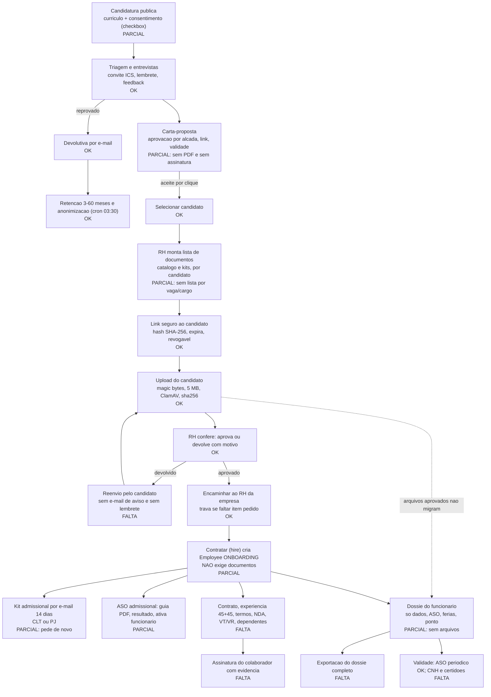

# 03 - Check-up dos documentos do ciclo de Recrutamento e Selecao

Data: 2026-10-30. Escopo: somente leitura do codigo. Nenhum segredo foi lido ou impresso.
Convencao de status: **OK** (completo e verificado no codigo), **PARCIAL** (existe, mas incompleto ou sem evidencia juridica/operacional), **FALTA** (nao existe).
Caminhos abreviados: `API` = `apps/api/src/modules`, `WEB` = `apps/web/app`.

## 1. Resumo executivo

O sistema tem um fluxo de **coleta de documentos do candidato por link** bem construido (token hasheado, expiracao, magic bytes, ClamAV, conferencia pelo RH com motivo de devolucao, versionamento por substituicao, trava no encaminhamento). O que **nao existe** e a segunda metade do ciclo: documentos **gerados** na admissao (contrato, experiencia 45+45, termos), **assinatura** com evidencia do candidato/colaborador, e a **migracao** dos documentos aprovados para o dossie do funcionario. Hoje o dossie do colaborador nao contem nenhum arquivo vindo do recrutamento (exceto o curriculo).

Contagem da matriz (secao 4, 40 itens): **7 OK, 24 PARCIAL, 9 FALTA**.

## 2. Inventario com evidencia (o que o sistema gera, recebe, guarda e assina)

### 2.1 Recebe do candidato

| Documento | Como entra | Formato / validacao | Armazenamento | Evidencia |
|---|---|---|---|---|
| Curriculo | Formulario publico de candidatura (`public-jobs.controller.ts`) | `ALLOW.RESUME` = pdf, docx; 5 MB; magic bytes via `inspectFile`; bloqueia PDF ativo (JS/Launch/EmbeddedFile); nome sanitizado; sha256 | Disco local `JobsStorageService` (`RECRUITMENT_RESUMES_PATH` ou `data/attachments/recruitment`) | `jobs/jobs.service.ts` (`ALLOW.RESUME`, `MAX_RESUME_SIZE`). **Sem ClamAV** (o scanner so e chamado em `recruitment-documents.service.ts`). |
| Documentos de admissao (RG, CPF, CTPS, etc.) | Link `/carreiras/documentos/[token]` | `ALLOW.DOCUMENT` = pdf, png, jpeg; 5 MB (`MAX_DOCUMENT_BYTES`); tipo real por assinatura binaria, nunca por extensao; PDF ativo bloqueado (default `blockActivePdf: true`); **ClamAV obrigatorio em producao (falha fechada)** | `JobsStorageService`, chave `companyId/documents/applicationId/uuid.ext`; tabela `RecruitmentDocument` com `sha256`, `size`, `mimeType`, `status` | `jobs/recruitment-documents.service.ts` (`publicUpload`), `recruitment-documents.rules.ts`, `candidate-document-scanner.service.ts` |
| Consentimento LGPD do candidato | Checkbox na candidatura | Booleano `consentGiven`, `consentAt`, `consentVersion` (= `PRIVACY_VERSION` `2026-10`) | Colunas em `Application` | `jobs/recruitment-privacy.service.ts` (`afterApply`); `WEB/carreiras/[companyId]/[jobId]/job-details.tsx` |
| Dados de diversidade / PCD | Formulario de candidatura | Opcoes fechadas (`GENDER_OPTIONS`, `RACE_OPTIONS`, `parsePcd`) | Tabela `CandidateDiversity` | `recruitment-privacy.ts`, `afterApply` |
| Aceite / recusa da proposta | Link `/carreiras/proposta/[token]` | Checkbox "li e concordo" + botao; recusa com motivo opcional | `JobOffer.status/respondedAt/declineReason` | `jobs/job-offer.service.ts` (`respond`), `WEB/carreiras/proposta/[token]/client.tsx` |
| Dados basicos do candidato (CPF, endereco, formacao) | Area do candidato (conta) com aceite `admissionShareConsent` | CPF validado | `CandidateAccount`; copiados para `Employee` na contratacao | `jobs.repository.ts` (`hire`, `admissionPrefill`) |

### 2.2 Gera

| Documento | Gerador | Formato | Guarda | Assinatura |
|---|---|---|---|---|
| Convite/lembrete de entrevista (+ `.ics`) | `RecruitmentPrivacyService.sendInterviewEmail`, `interview-followup.service.ts` (cron horario) | E-mail + ICS | Evento na linha do tempo (`ApplicationEvent`) | Nenhuma |
| Feedback de reprovacao | `afterRejected` | E-mail configuravel (`rejectionMessage`) | Evento `REJECTION_EMAIL_SENT` | Nenhuma |
| Carta-proposta | `JobOfferService` (cria, aprova por alcada, envia) | Pagina web publica + e-mail; **nao ha PDF** | `JobOffer` (campos mutaveis) | Nenhuma (clique de aceite) |
| E-mail "parabens, envie seus documentos" | `sendHireWelcome` (apos `hire`) | E-mail com link (14 dias) e kit CLT/PJ (`hireKitFor`) | `RecruitmentDocumentRequest` | Nenhuma |
| Guia de encaminhamento ao ASO | `ManagementDocumentsService.generateAsoReferral` | PDF (`PdfReport`), NR-7 2026.1 | `GeneratedDocument` (sha256, imutavel) | Linhas de assinatura em branco |
| Ficha de registro do empregado | `EmployeeDocumentsService` (`EMPLOYEE_RECORD`) | PDF; inclui documentos, endereco, contrato, banco, dependentes | `GeneratedDocument` | Linhas de assinatura em branco (colaborador e RH) |
| Espelho de ponto, ficha de ocorrencias | `EmployeeDocumentsService` | PDF | `GeneratedDocument` | Linhas em branco |
| Advertencia / suspensao | `DocumentTemplatesController` (render) + `generateLegalNotice` | Texto de modelo + PDF | `GeneratedDocument` | Linhas em branco |
| Termo de aceite da plataforma (usuario) | `PrivacyService.accept` + `generatePDFBase64` | PDF com evidencias | `PrivacyConsent.pdfBase64` (coluna Text) | **RSA-SHA256 da plataforma**, so se `PRIVACY_RSA_PRIVATE_KEY` existir; sem a chave grava `signatureAlgorithm = 'none'` |
| Contrato do CEO | `CeoOnboardingService` | PDF + hash do conteudo | `GeneratedDocument` | **Assinatura avancada via gov.br**; upload do PDF assinado (`ALLOW.SIGNED_PDF`, 10 MB), contagem de `/ByteRange`, conferencia de prefixo PAdES, confirmacao manual no validador do ITI |

### 2.3 Controles transversais verificados

| Pergunta | Resposta | Evidencia |
|---|---|---|
| Lista de documentos exigidos configuravel por vaga/cargo? | **PARCIAL.** Existe catalogo e kits (`DOCUMENT_CATALOG`, `DOCUMENT_KITS`) na tela e um kit padrao por tipo de contrato (`hireKitFor`: so CLT ou PJ). Nao ha campo em `Job` nem cadastro por cargo: o RH remonta a lista a cada candidato. | `WEB/.../documents-model.ts`, `document-picker.tsx`, `recruitment-documents.rules.ts`; `model Job` sem campo de documentos |
| Candidato envia pelo link? Token expira? Hash? | **OK.** 32 bytes `base64url`, so o SHA-256 vai ao banco; padrao 7 dias, limite 30 (14 dias no kit da contratacao); revogavel; encaminhar revoga; `Cache-Control: no-store`, `X-Robots-Tag: noindex`; throttle 30/min (ver) e 10/min (upload). Sem segundo fator (OTP) no link. | `generateAccessToken`, `linkState`, `PublicCandidateDocumentsController` |
| RH confere, aprova, recusa com motivo, pede reenvio? | **OK.** `review` com `APPROVED`/`RETURNED`, motivo minimo 5 caracteres, decisao condicional (sem corrida), reenvio substitui (`supersededAt`) e o historico fica. **Lacuna:** a devolucao nao dispara e-mail ao candidato (nao ha `mail.send` em `review`). | `recruitment-documents.service.ts` |
| Lembrete automatico de pendencia? | **FALTA.** Crons existentes: lembrete de entrevista, retencao LGPD, retry de workflow. Nenhum para documentos pendentes ou link a vencer. | `interview-followup.service.ts`, `recruitment-privacy.service.ts`, `recruitment-workflow.service.ts` |
| Checklist bloqueia a contratacao enquanto faltar obrigatorio? | **PARCIAL.** (a) `forward` exige todos os itens pedidos aprovados; (b) mover para etapa `COMPLETE_ADMISSION` exige proposta aceita e todos os itens aprovados (`recruitment.service.ts`, `moveInTx`). Mas `JobsService.hire` **nao** verifica documentos: cria o funcionario (`status ONBOARDING`) e so depois envia o kit. O gate cobre apenas o que o RH decidiu pedir (minimo 1 item, sem kit obrigatorio por contrato). | `jobs.service.ts` `hire`, `jobs.repository.ts` `hire` |
| Aprovados migram para o dossie sem redigitar? | **FALTA.** `hire` copia so o curriculo como `Attachment` (`ownerType EMPLOYEE`) e preenche CPF/endereco/formacao a partir da conta do candidato. `RecruitmentDocument` nao e lido por nenhum modulo de funcionarios; o dossie nao lista anexos. | `jobs.repository.ts` `hire`; `employees.repository.ts` `getDossier` (retorna employee, ASO, ferias, ponto, ocorrencias) |
| Exportacao do dossie completo? | **FALTA.** Existem PDFs avulsos (ficha, espelho, ocorrencias). O "dossie" e um JSON mostrado numa gaveta (`EmployeeDossierDrawer`); a tela de exclusao apenas orienta "baixe o dossie antes". Nao ha pacote com documentos. | `employees.controller.ts`, `WEB/[tenant]/dashboard/employees/page.tsx` |
| Controle de validade? | **PARCIAL.** ASO: `dueDate`, `periodicityMonths` (6/12/24), cron diario 06:00 gera ASO periodico, alertas ao RH (`aso-rules.ts`, `sst.cron.ts`, `getRhAlerts`). Demais documentos (CNH, certidoes, antecedentes): sem campo de validade. | `schema.prisma` `EmployeeAsoRecord`; `RecruitmentDocument` sem `expiresAt` |
| Retencao e exclusao LGPD do candidato nao contratado? | **PARCIAL/OK.** `retentionUntil` na candidatura (padrao 12 meses, 3 a 60 configuravel), cron 03:30 anonimiza (apaga curriculo, arquivos de documentos, respostas, notas), pedidos do titular (acesso, correcao, exclusao), resposta generica que nao revela existencia do e-mail. Lacunas: contratados ficam sem politica propria; `RecruitmentDocumentRequest` nao e apagado na anonimizacao; o export de acesso nao lista documentos. | `recruitment-privacy.service.ts` (`purgeExpired`, `anonymizeCandidate`, `exportCandidateData`) |
| Criptografia / permissao de leitura? | Arquivos em disco local **sem criptografia da aplicacao**. Leitura restrita a `DEV/ADMIN/RH/RH_RS` com modulo `recruitment` e escopo da vaga (`JobScopeService`); download gera `AuditLog` e `X-Content-Type-Options: nosniff`, `private, no-store`. Foto e PDF do aceite da plataforma ficam em colunas `Text` base64 no Postgres (`PrivacyConsent.photoBase64/pdfBase64`). | `recruitment-documents.controller.ts`, `jobs-storage.service.ts`, `schema.prisma` |

## 3. Achado de seguranca/LGPD fora do codigo-fonte

Oito arquivos sob `apps/api/data/attachments/recruitment/<companyId>/...` (2 PDFs de curriculo por candidatura e PNGs em `.../documents/<applicationId>/`) estao **versionados no git** (`git ls-files apps/api/data` retorna 8 itens) e a pasta nao esta no `.gitignore`. Se forem dados reais, sao dados pessoais de candidatos no repositorio. Conteudo nao foi aberto. Ver RS-D-01.

## 4. Matriz: documento x etapa x status

Etapas: **C** Candidatura, **S** Selecao/entrevista, **P** Proposta, **A** Admissao (coleta), **E** Colaborador/dossie.

| # | Documento | Etapa | Quem gera/anexa | Formato | Validacao / assinatura | Status |
|---|---|---|---|---|---|---|
| D01 | Politica de privacidade do candidato (`/carreiras/privacidade`, versao `2026-10`) | C | Plataforma | Pagina | Versionada; pedidos do titular | **OK** |
| D02 | Consentimento LGPD do candidato | C | Candidato (checkbox) | Booleano + versao | Sem texto/hash do termo, sem IP/UA, sem PDF, sem revogacao pelo candidato | **PARCIAL** |
| D03 | Consentimento p/ dados sensiveis (diversidade, PCD) | C | Candidato | Campos opcionais | Opcoes fechadas, mas sem consentimento especifico nem base legal registrada | **PARCIAL** |
| D04 | Curriculo | C | Candidato | PDF/DOCX 5 MB | Magic bytes, PDF ativo bloqueado; sem antivirus | **PARCIAL** |
| D05 | Parecer/ficha de entrevista do recrutador | S | Recrutador (`InterviewFeedback`) | Registro no sistema | Sem PDF/assinatura; nao verificado em profundidade | **PARCIAL** |
| D06 | Comprovante de entrevista agendada | S | Sistema | E-mail + ICS | Registrado na linha do tempo | **OK** |
| D07 | Devolutiva ao candidato reprovado | S | Sistema | E-mail configuravel | Evento registrado, sem duplicar | **OK** |
| D08 | Carta-proposta / oferta | P | RH (aprovacao por alcada) | Pagina web, sem PDF | Validade 1-30 dias; aceite por clique sem IP/UA/hash/snapshot; `JobOffer.token` em texto puro; campos editaveis apos envio nao versionados | **PARCIAL** |
| D09 | RG ou CNH | A | Candidato | PDF/PNG/JPEG | Rotulo livre; sem tipo estruturado, validade ou OCR | **PARCIAL** |
| D10 | CPF | A | Candidato | idem | idem | **PARCIAL** |
| D11 | Comprovante de residencia | A | Candidato | idem | idem | **PARCIAL** |
| D12 | Foto 3x4 | A | Candidato | idem | Sem checagem de dimensao/rosto | **PARCIAL** |
| D13 | CTPS digital | A | Candidato | idem | idem | **PARCIAL** |
| D14 | Titulo de eleitor / quitacao | A | Candidato | idem | idem | **PARCIAL** |
| D15 | Certificado de reservista | A | Candidato | idem | idem | **PARCIAL** |
| D16 | Certidao de nascimento/casamento | A | Candidato | idem | idem | **PARCIAL** |
| D17 | Escolaridade, certificados, diplomas | A | Candidato | idem | `ALLOW.CERTIFICATE` (inclui webp) existe, mas nenhum fluxo o usa | **PARCIAL** |
| D18 | PIS/PASEP/NIS | A | Candidato | idem | Numero nao e extraido para `Employee.pis` | **PARCIAL** |
| D19 | Dados bancarios | A | Candidato (comprovante) | idem | Campos `bank*` do `Employee` nao sao alimentados pelo upload | **PARCIAL** |
| D20 | Documentos dos dependentes (CPF, certidao, vacina, frequencia escolar) | A | Candidato | idem | Itens no catalogo; `Employee.dependents` e JSON solto, sem formulario | **PARCIAL** |
| D21 | Declaracao de dependentes (IRRF / salario-familia) | A | - | - | Sem modelo, sem formulario, sem assinatura | **FALTA** |
| D22 | Opcao de vale-transporte | A | - | - | Existe so o rotulo "Declaracao de vale-transporte" para o candidato enviar arquivo proprio; sem modelo | **FALTA** |
| D23 | Opcao de vale-refeicao / beneficios | A | - | - | Nao existe | **FALTA** |
| D24 | Certidao de antecedentes (quando a vaga exige) | A | Candidato | idem | Item opcional do catalogo; sem flag de exigencia legitima/base legal | **PARCIAL** |
| D25 | Comprovante de vacinacao (quando aplicavel) | A | Candidato | idem | Item de catalogo; sem regra por vaga | **PARCIAL** |
| D26 | Laudo / CID para PCD | A | - | - | So existe o flag `pcd` de diversidade; sem item, sem acesso restrito de dado sensivel | **FALTA** |
| D27 | ASO admissional (resultado) | A/E | Clinica / RH | `EmployeeAsoRecord` + `attachmentId` | Registro criado no `hire`, status, apto/inapto, ativa o funcionario; nao encontrei upload do arquivo do ASO com magic bytes | **PARCIAL** |
| D28 | Guia de encaminhamento ao ASO | A | Sistema | PDF `PdfReport` | sha256 imutavel, versao NR-7 | **OK** |
| D29 | Contrato de trabalho | A/E | - | - | `DocumentTemplate` so aceita ADVERTENCIA, SUSPENSAO, COMUNICADO, OUTRO; tarefa `CONTRACT_SIGN` do onboarding e so um item marcavel | **FALTA** |
| D30 | Contrato de experiencia (45+45) | A/E | - | - | Sem modelo, prazos ou alerta de vencimento da experiencia | **FALTA** |
| D31 | Ficha de registro de empregado | E | Sistema | PDF | Completa em campos, mas assinatura so impressa e nao usa documentos do recrutamento | **PARCIAL** |
| D32 | Termo de responsabilidade / uso de equipamento | E | - | - | Nao existe | **FALTA** |
| D33 | Termo de confidencialidade (NDA) | A/E | - | - | So como item PJ "NDA assinado" (upload de arquivo externo) | **FALTA** |
| D34 | Termo LGPD do colaborador | E | Plataforma | PDF + hash + RSA opcional | Vinculado a `User` (termo de uso da plataforma), nao a ciencia de tratamento de dados de RH; RSA depende de env | **PARCIAL** |
| D35 | Advertencia / suspensao (modelos + PDF) | E | RH | Modelo + PDF | Auditado (criacao, edicao, exclusao); sem versao do modelo | **OK** |
| D36 | Assinatura avancada gov.br (padrao ja existente no contrato do CEO) | E | CEO/DEV | PDF PAdES | Verifica PDF, `/ByteRange`, prefixo, confirmacao ITI. Padrao reaproveitavel, hoje fora do fluxo de admissao | **OK** (referencia) |
| D37 | Dossie do colaborador (gaveta) | E | Sistema | JSON na tela | Sem documentos anexos nem historico do recrutamento | **PARCIAL** |
| D38 | Espelho de ponto / ocorrencias | E | Sistema | PDF | sha256, versao `EMPLOYEE_DOCS_2026_1` | **OK** |
| D39 | Exportacao do dossie completo (pacote) | E | - | - | Nao existe | **FALTA** |
| D40 | Checklist de admissao (`OnboardingFlow`) | A/E | RH | Tarefas fixas | 7 tarefas padrao; `completeTask` e manual; `uploadDocument` existe no repositorio sem rota; independente do `RecruitmentDocument`; botao "Documentos" leva a `escalas?view=fechamento` | **PARCIAL** |

**Contagem:** OK 7 (D01, D06, D07, D28, D35, D36, D38) - PARCIAL 24 - FALTA 9 (D21, D22, D23, D26, D29, D30, D32, D33, D39). Total 40.

## 5. Fluxo atual (candidato ate o dossie)

## 6. Lista de lacunas priorizada

Legenda: P0 bloqueia lancamento; P1 necessario para um fluxo de documentos completo; P2 endurecimento. Esforco em horas de desenvolvimento + teste.

| ID | Prio | Lacuna | Evidencia | Acao proposta | Esforco |
|---|---|---|---|---|---|
| RS-D-01 | P0 | Arquivos de candidatos versionados no git, pasta fora do `.gitignore` | `git ls-files apps/api/data` = 8 arquivos | Confirmar se sao dados reais; `git rm --cached`, `.gitignore` para `apps/api/data/`, reescrever historico se reais, tratar como incidente LGPD | 4 h |
| RS-D-02 | P0 | Documentos aprovados nao migram para o dossie | `jobs.repository.ts` `hire` copia so curriculo; `getDossier` sem anexos | No `hire`, copiar/vincular `RecruitmentDocument` aprovados a anexo do funcionario (novo `EmployeeDocument` com tipo, hash, origem); listar no dossie; extrair PIS, banco, dependentes para campos do `Employee` | 16 h |
| RS-D-03 | P0 | Contratacao nao bloqueia por documento obrigatorio | `JobsService.hire` nao consulta documentos; kit enviado so apos criar o funcionario; gate depende do que o RH pediu | Kit minimo obrigatorio por tipo de contrato; `hire` exige itens aprovados (ou justificativa auditada); funcionario so sai de `ONBOARDING` com checklist completo | 10 h |
| RS-D-04 | P0 | Sem contrato de trabalho, experiencia 45+45, termos de equipamento/NDA/dependentes/VT/VR | `TEMPLATE_KINDS` so disciplinar; `TEMPLATE_VARIABLES` sem salario, jornada, admissao, prazo | Novos `kind` (CONTRATO, EXPERIENCIA, TERMO, DECLARACAO), variaveis de contrato, geracao em PDF via `PdfReport`, versao do modelo e hash, alerta de fim de experiencia (45 e 90 dias) | 24 h |
| RS-D-05 | P0 | Aceite da proposta e documentos sem assinatura com evidencia | `respond` grava so status e data; `JobOffer.token` em texto puro; sem snapshot do texto | Assinatura eletronica simples: PDF da proposta/contrato, hash, IP, user agent, data, e-mail verificado; token hasheado. Opcional avancada: upload gov.br reaproveitando `signed-pdf.rules.ts` (+8 h) | 20 h |
| RS-D-06 | P1 | Consentimento do candidato sem prova | Apenas `consentGiven/At/Version` | Guardar hash do texto, IP, UA; recibo por e-mail; revogacao pelo candidato; consentimento separado para banco de talentos e dados sensiveis | 10 h |
| RS-D-07 | P1 | Sem lembrete de pendencia; devolucao nao avisa o candidato | Nenhum cron de documentos; `review` sem `mail.send` | E-mail na devolucao com o motivo; cron diario que lembra pendentes (D-3, D-1 do vencimento) e avisa o RH; reemitir link sem perder historico | 8 h |
| RS-D-08 | P1 | Dados sensiveis sem tratamento reforcado (PCD/CID, antecedentes, vacina, ASO) | `pcd` so como flag; `attachmentId` do ASO sem upload tipado | Categoria "sensivel" com base legal, leitura so RH, auditoria de leitura, upload de ASO com `inspectFile` e ClamAV | 12 h |
| RS-D-09 | P1 | Lista de documentos nao e configuravel por vaga/cargo | `model Job` sem campo; `hireKitFor` so CLT/PJ | Campo `requiredDocuments` na vaga/cargo, pre-carregado ao selecionar candidato, kits por contrato (estagio, aprendiz, temporario) | 8 h |
| RS-D-10 | P1 | Dependentes, VT e VR sem formulario | `Employee.dependents` JSON; catalogo so pede arquivo | Formulario no link do candidato (dependentes, VT, VR) gravando em dados estruturados e gerando as declaracoes assinadas | 16 h |
| RS-D-11 | P1 | Sem validade para documentos alem do ASO | `RecruitmentDocument` sem `expiresAt` | `expiresAt` opcional na conferencia + alerta ao RH (CNH, certidoes, vacina) | 8 h |
| RS-D-12 | P1 | Sem exportacao do dossie completo | Apenas PDFs avulsos | Pacote ZIP (ficha, documentos, ASO, contratos, termos) com manifesto de hashes, auditado, usado tambem no pedido de acesso LGPD | 12 h |
| RS-D-13 | P1 | Curriculo sem antivirus | `jobs.service.ts` nao usa `CandidateDocumentScanner` | Chamar `assertClean` no upload do curriculo | 3 h |
| RS-D-14 | P2 | Arquivos sem criptografia da aplicacao; base64 de foto/PDF no Postgres | `JobsStorageService` grava bytes puros; `PrivacyConsent.photoBase64/pdfBase64` | AES-256-GCM com chave por empresa (KMS/env), mover base64 para o storage | 12 h |
| RS-D-15 | P2 | Retencao de contratados e residuos | `anonymizeCandidate` ignora HIRED; `RecruitmentDocumentRequest` permanece; export de acesso sem documentos | Politica de guarda para contratados (prazos trabalhistas), apagar requests, incluir documentos no export | 8 h |
| RS-D-16 | P2 | Documento identificado por rotulo livre | `label` de ate 60 caracteres; `ALLOW.CERTIFICATE` sem uso | Enum `docType` por item, regras por tipo (formatos, validade, obrigatoriedade), usar `ALLOW.CERTIFICATE` para diplomas | 10 h |
| RS-D-17 | P2 | Link de upload sem segundo fator | So o token autentica | Codigo por e-mail/WhatsApp antes do upload ou vinculo com a conta do candidato | 6 h |
| RS-D-18 | P2 | Onboarding desconectado dos documentos | `OnboardingDocument` sem rota; tarefas manuais; botao "Documentos" aponta para escalas | Gerar o checklist a partir do kit e dos itens aprovados, marcar tarefas automaticamente | 8 h |
| RS-D-19 | P2 | Upload do candidato sem trilha de auditoria | `publicUpload` nao grava `AuditLog` nem IP | Registrar envio (hash, IP, UA, rotulo) | 3 h |

Totais: P0 74 h (82 h com assinatura avancada), P1 77 h, P2 47 h. Total aproximado 198 h.

## 7. Observacoes finais

- Ponto forte a preservar: `inspectFile` (magic bytes, PDF ativo, ZIP bomb), `CandidateDocumentScanner` com falha fechada em producao, tokens hasheados, decisao do RH condicional ao estado lido, trava `DOCUMENTS_NOT_READY`.
- O padrao de assinatura avancada ja existe no contrato do CEO (gov.br + PAdES + validador ITI) e pode ser generalizado em vez de criar um provedor novo.
- Nao foram executados testes nem a aplicacao; as conclusoes vem da leitura do codigo e do schema Prisma. Itens nao verificados em profundidade: texto da pagina `/carreiras/privacidade`, conteudo de `InterviewFeedback`, rotas de upload do ASO.
